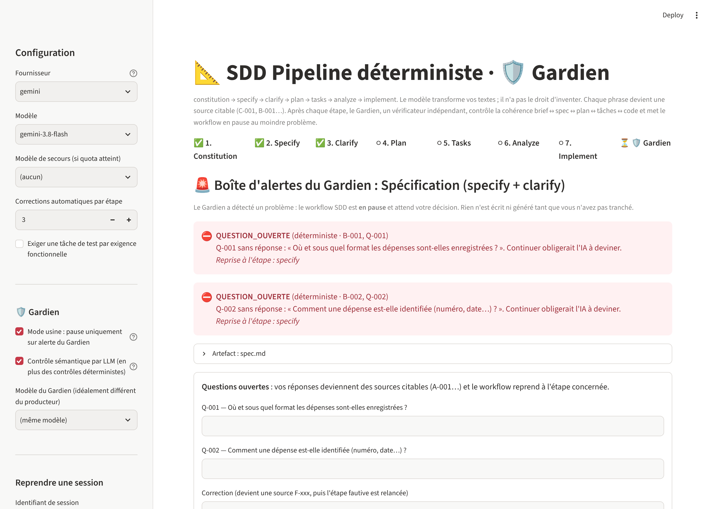
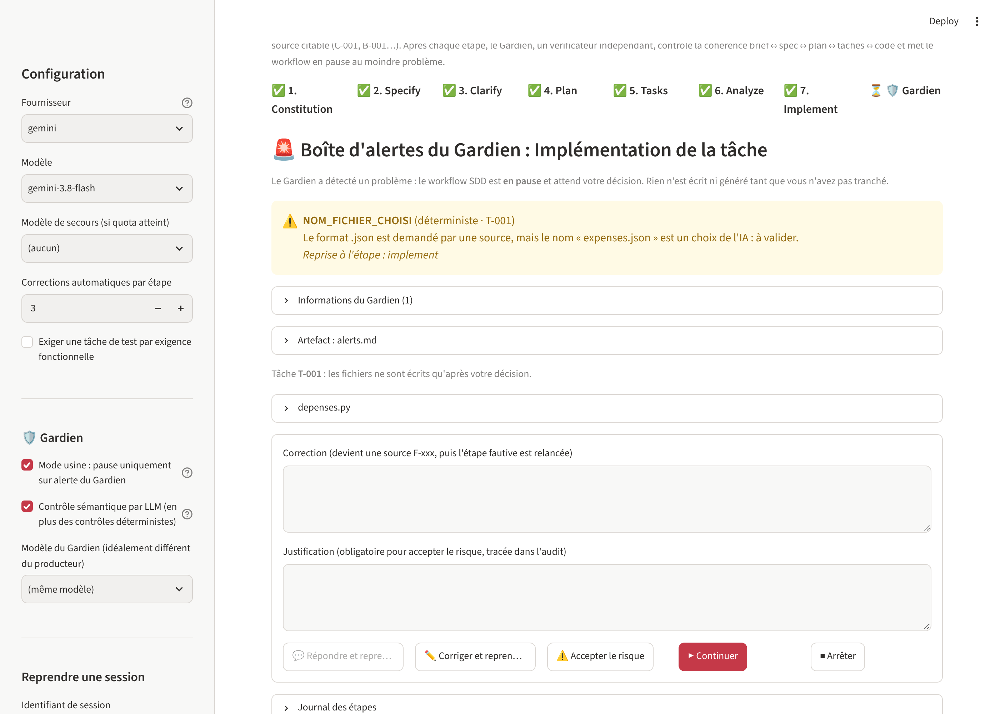
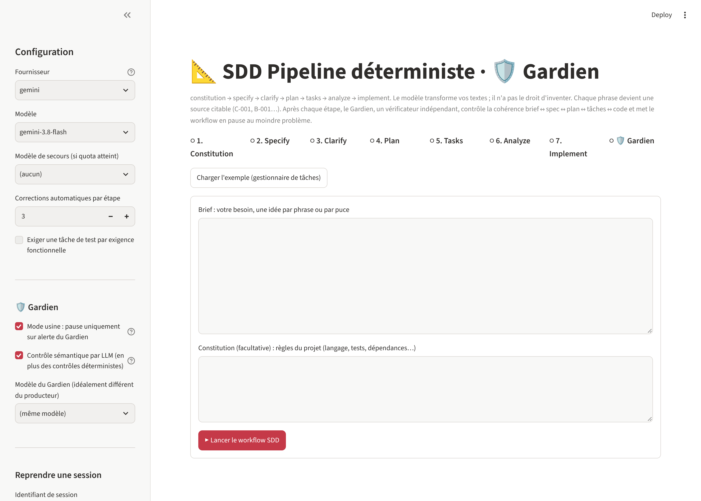
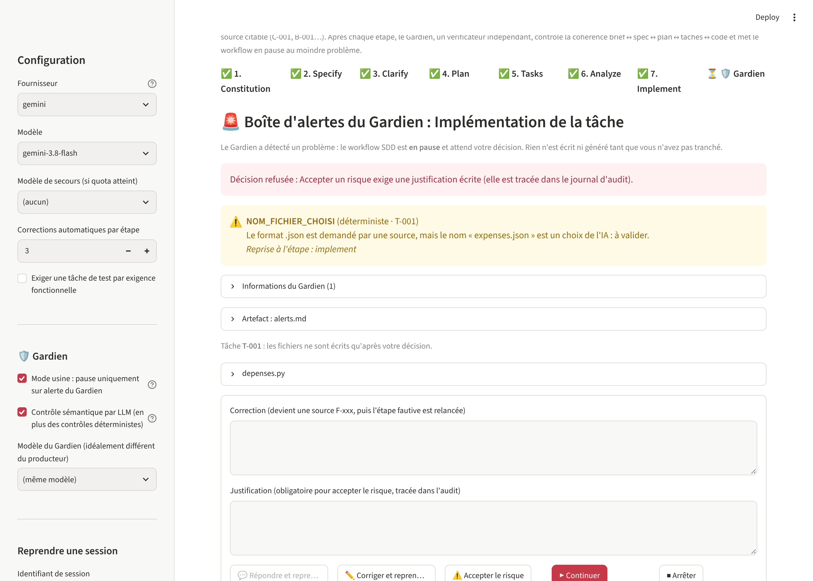
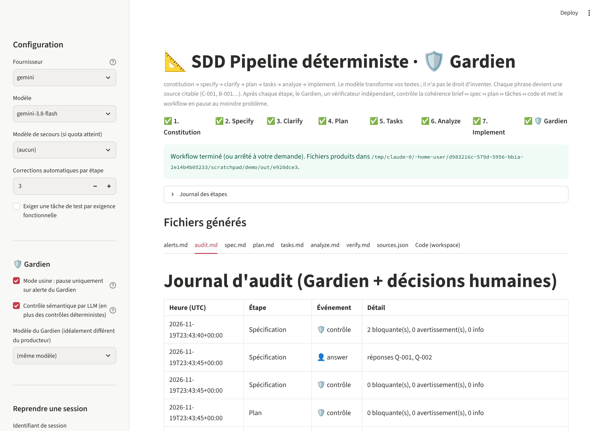

# Avant-propos : comment lire ce rapport

Ce document explique **tout** le projet, depuis le problème de départ jusqu'à la dernière ligne de code : pourquoi
il existe, comment LangChain et LangGraph fonctionnent, comment le workflow SDD est construit, ce qu'est le
**Gardien** (le vérificateur indépendant qui met le workflow en pause au moindre problème), comment
l'interface web s'utilise, quels choix ont été faits et pourquoi. Il remplace entièrement le rapport précédent.

- **Partie I (chapitres 1 et 2)** : le problème et la méthode (Spec-Driven Development, spec-kit).
- **Partie II (chapitres 3 et 4)** : les briques techniques, LangChain puis LangGraph, avec leurs concepts standards.
- **Partie III (chapitres 5 à 11)** : l'architecture « AI factory ». Le principe du Gardien, l'architecture
  générale, le producteur étape par étape, la construction détaillée du Gardien, l'étude du cas réel qui a motivé
  le Gardien, les garde-fous et le modèle de données.
- **Partie IV (chapitre 12)** : l'interface web et la boîte d'alertes.
- **Partie V (chapitres 13 à 19)** : le choix du modèle, le code fichier par fichier, les tests, les exécutions
  réelles, l'installation (avec les commandes Git), les limites et un glossaire.
- L'**annexe** contient l'intégralité du code source.

Convention : les noms de fichiers, de fonctions et de commandes sont écrits `comme ceci`.

# Partie I : le contexte

# 1. Le problème : pourquoi un SDD « déterministe » ?

## 1.1 Le développement assisté par IA et ses dérives

Quand on demande à un modèle de langage (LLM) de « coder une application de gestion de tâches », il produit
volontiers beaucoup plus que ce qui a été demandé : des priorités, des dates d'échéance, une authentification,
une base de données, une API REST… Rien de tout cela n'était dans la demande. Le modèle **complète** avec ce qui
lui semble probable, parce qu'il est entraîné à produire du texte plausible, pas à respecter un périmètre.

Ce comportement pose trois problèmes concrets :

1. **Dérive du périmètre** : on livre des fonctionnalités que personne n'a demandées, qu'il faut maintenir, tester et sécuriser.
2. **Hallucination** : le modèle affirme des contraintes ou des règles métier qui n'existent pas (« le titre est limité à 100 caractères »).
3. **Perte de traçabilité** : on ne sait plus pourquoi une ligne de code existe, ni quelle exigence elle sert.

## 1.2 Le Spec-Driven Development (SDD)

Le **Spec-Driven Development** répond à ce problème en inversant l'ordre habituel : au lieu de partir du code,
on part d'une **spécification** écrite, qu'on transforme progressivement en plan technique, puis en liste de
tâches, puis en code. Chaque étape produit un artefact relu et validé avant de passer à la suivante. La
spécification devient la source de vérité ; le code n'en est qu'une conséquence.


## 1.3 Ce que ce projet ajoute : le déterminisme

Le SDD classique avec un agent IA reste vulnérable : à chaque étape, le LLM peut encore ajouter des choses.
L'objectif de ce projet est de rendre le workflow **le plus déterministe possible** :

> **Le LLM propose, du code déterministe dispose.**

Concrètement :

- Tout ce qui peut être fait **sans LLM** est fait sans LLM (découpage du besoin, contrôles de cohérence, exécution
  des tests, rendu des documents).
- Chaque sortie du LLM est **structurée** (JSON conforme à un schéma) puis **vérifiée par du code** : citations
  exactes, couverture, références, périmètre des fichiers.
- Toute information doit avoir une **origine traçable** : une phrase du besoin, de la constitution, ou une réponse de l'humain.
- Quand une information manque, le LLM doit **poser une question** au lieu de supposer, et c'est l'humain qui répond.

« Déterministe » ne veut pas dire que le LLM produit toujours exactement le même texte (même à température 0, ce
n'est pas garanti). Cela veut dire que **les règles d'acceptation sont déterministes** : un artefact qui contient
une information non sourcée est rejeté, à chaque fois, quel que soit le texte exact produit.

## 1.4 De la chaîne contrôlée à l'« AI factory »

La première version du projet plaçait des contrôles **dans** chaque étape (le producteur se vérifiait lui-même)
et des **points de contrôle humains** à la fin de chaque étape. Un test réel (chapitre 9) a montré la limite de
ce modèle : les réponses de l'utilisateur aux questions ont été perdues, les questions sont restées ouvertes, et
le pipeline a pourtant généré du code. L'IA a donc tranché seule ce que l'humain n'avait pas validé (nom de
fichier, format des identifiants, interface en ligne de commande). Le contrôle croisé l'avait vu, mais ne
l'affichait qu'en simple avertissement, que l'humain pouvait approuver d'un clic.

D'où la nouvelle architecture, que l'on peut appeler une **« AI factory »** (une usine à logiciel pilotée par
l'IA) :

- **d'un côté, un outil qui déroule le SDD** (le *producteur*) ;
- **de l'autre, un outil indépendant qui vérifie la cohérence** entre cas d'usage, spécification, plan, tâches
  et code (le **Gardien**) ;
- en cas de problème ou d'incohérence, le Gardien **lève une alerte**, **met le workflow SDD en pause** et
  **attend l'intervention de l'humain** pour continuer.

C'est le principe des **quatre yeux** (*four-eyes principle*) bien connu en finance ou en aéronautique : celui
qui produit n'est jamais celui qui valide. Le chapitre 5 détaille ce principe, le chapitre 8 sa réalisation.

# 2. Le workflow SDD : les étapes de spec-kit

## 2.1 spec-kit en bref

**spec-kit** est la boîte à outils open source de GitHub pour le Spec-Driven Development. Elle fournit des
commandes à utiliser dans un agent de code (`/speckit.constitution`, `/speckit.specify`, etc.) qui guident
l'agent étape par étape. Ce projet **n'utilise pas l'outil spec-kit** : il reprend **le même enchaînement
d'étapes**, mais l'implémente lui-même avec LangGraph, afin d'ajouter à chaque étape des contrôles déterministes
et un vérificateur indépendant que spec-kit ne fournit pas (spec-kit s'appuie sur la discipline de l'agent ;
ici, c'est du code qui vérifie, et c'est un humain qui tranche).

## 2.2 Les sept étapes et leur correspondance

| Étape spec-kit | Rôle dans spec-kit | Nœud(s) LangGraph | LLM ? | Contrôlé par le Gardien |
|---|---|---|---|---|
| `constitution` | Principes non négociables du projet | `constitution` | Non | (sources) |
| `specify` | Décrire le *quoi* et le *pourquoi* | `specify` | Oui | avec clarify |
| `clarify` | Lever les ambiguïtés par questions | `clarify` | Oui (questions seulement) | **oui** (étape `spec`) |
| `plan` | Décider le *comment* technique | `plan` | Oui | **oui** (étape `plan`) |
| `tasks` | Découper en tâches ordonnées | `tasks` | Oui | avec analyze |
| `analyze` | Vérifier la cohérence spec/plan/tâches | `analyze` | **Non** | **oui** (étape `analyze`) |
| `implement` | Exécuter les tâches | `implement`, `apply_impl`, `verify`, `fix` | Oui (sauf verify) | **oui** (étapes `impl` et `verify`) |

Deux nœuds s'ajoutent, qui ne sont pas des étapes de spec-kit : **`guardian`** (le contrôle) et **`gate`** (la
pause humaine). Trois différences volontaires avec spec-kit :

- **constitution** : dans spec-kit, l'agent rédige la constitution. Ici, c'est un fichier que **vous** écrivez ;
  le pipeline la découpe en énoncés numérotés sans la modifier.
- **analyze** : dans spec-kit, c'est un LLM qui relit les artefacts. Ici, c'est **100 % du code**.
- **les points de contrôle** : dans spec-kit, l'agent décide quand s'arrêter. Ici, c'est le Gardien qui décide de
  la pause, et seul l'humain peut la lever.

## 2.3 Les entrées du pipeline

Le pipeline prend deux textes écrits par l'humain :

- **la constitution** (`examples/constitution.md`) : les règles globales (langage, outils de test, dépendances autorisées…) ;
- **le brief** (`examples/brief.md`) : le besoin fonctionnel.

Exemple de brief fourni :

```markdown
# Gestionnaire de tâches en ligne de commande
- L'utilisateur peut ajouter une tâche avec un titre.
- L'utilisateur peut lister les tâches.
- L'utilisateur peut marquer une tâche comme terminée.
- Les tâches sont sauvegardées dans un fichier JSON local.
```

Ces deux textes, plus les réponses et corrections de l'humain pendant le processus, sont **les seules sources de
vérité**.

# Partie II : les briques techniques

# 3. LangChain : les concepts utilisés

LangChain est une bibliothèque Python qui fournit des abstractions standard pour travailler avec les LLM.
Le projet en utilise uniquement les briques classiques, décrites ici.

## 3.1 Le Chat Model

Un *chat model* est un objet qui représente un LLM conversationnel. Tous les fournisseurs (OpenAI, Groq,
Google, Ollama…) exposent la même interface : `invoke(messages)` renvoie un message de réponse. Dans le projet :

```python
from langchain_google_genai import ChatGoogleGenerativeAI
llm = ChatGoogleGenerativeAI(model="gemini-3.8-flash", temperature=0, seed=42, timeout=120, max_retries=3)
```

Changer de fournisseur revient à changer de classe (`ChatGroq`, `ChatOllama`) : le reste du code
ne bouge pas. C'est tout l'intérêt de l'abstraction, et c'est ce que fait `src/sdd/llm.py`.

**`temperature=0`** demande au modèle de choisir systématiquement le mot le plus probable : c'est le réglage le
moins créatif et le plus reproductible. Exception : pour les modèles **Gemini 3**, Google recommande « fortement »
de garder la valeur par défaut 1.0, car en dessous le modèle peut **tourner en boucle** et ne jamais finir sa
réponse. Le projet suit donc cette recommandation pour Gemini 3 (`SDD_GEMINI_TEMPERATURE`, défaut 1.0) et garde 0
ailleurs. Ce n'est pas un recul du déterminisme : il repose sur les schémas et les validateurs, qui refusent toute
sortie qui invente, quelle que soit la température (chapitre 10).

## 3.2 Les messages

Une conversation est une liste de messages typés :

- `SystemMessage` : les instructions de rôle et les règles (« tu es analyste, tu n'inventes rien… ») ;
- `HumanMessage` : la demande (ici, les sources et artefacts à transformer) ;
- `AIMessage` : une réponse du modèle.

Le projet utilise `AIMessage` + `HumanMessage` pour la **boucle de correction** : on remet au modèle sa propre
réponse, suivie de la liste des erreurs détectées, et on lui demande de corriger.

## 3.3 Les prompt templates

Un `ChatPromptTemplate` est un gabarit de conversation avec des variables. Le projet en construit un par appel :

```python
prompt = ChatPromptTemplate.from_messages([
    ("system", system),                                   # règles + rôle de l'étape
    ("human", "{input}"),                                 # sources / artefacts
    MessagesPlaceholder("corrections", optional=True),    # historique des corrections
])
```

`MessagesPlaceholder` est un emplacement où l'on injecte une liste de messages : vide au premier essai, puis
remplie des réponses rejetées et des erreurs.

## 3.4 LCEL : chaîner avec `|`

LCEL (*LangChain Expression Language*) permet de composer des composants avec l'opérateur `|`, comme un pipe
Unix. La sortie de l'un devient l'entrée du suivant :

```python
chain = prompt | llm.with_structured_output(Spec, method="json_schema")
spec = chain.invoke({"input": sources_text, "corrections": []})
```

Le gabarit produit des messages, le modèle les reçoit et renvoie un objet `Spec`.

## 3.5 La sortie structurée : `with_structured_output`

C'est la brique la plus importante pour le déterminisme. `llm.with_structured_output(Schema)` transforme le
modèle pour qu'il renvoie **un objet Python validé** (ici une classe Pydantic) au lieu de texte libre.

Il existe plusieurs méthodes :

- `function_calling` : le schéma est présenté comme un « outil » que le modèle doit appeler. Le modèle peut
  refuser et répondre en texte (c'est arrivé pendant les essais réels, voir chapitre 16).
- `json_schema` : le fournisseur **contraint la génération** pour que la sortie respecte le schéma JSON. C'est
  la méthode choisie par défaut (variable `SDD_STRUCTURED_METHOD`).
- `json_mode` : le modèle renvoie du JSON, sans garantie de schéma.

## 3.6 Pydantic

Pydantic est la bibliothèque de validation de données utilisée par LangChain. Chaque artefact (spec, plan,
tâches, implémentation) est une classe Pydantic. Le projet les déclare toutes avec `extra="forbid"` : un champ
inconnu provoque une erreur. Le LLM ne peut donc pas glisser d'information « en douce » hors du schéma.
Les contraintes `min_length=1` imposent par exemple qu'une exigence ait au moins une citation.

## 3.7 Les fallbacks : `with_fallbacks`

Tout composant LangChain (un *runnable*) possède la méthode standard `with_fallbacks([...])` : si l'appel
échoue (quota atteint, panne, erreur réseau), LangChain réessaie automatiquement avec le composant de secours.
Le projet s'en sert pour basculer vers un second modèle gratuit :

```python
model = llm.with_structured_output(Spec, method="json_schema")
model = model.with_fallbacks([secours.with_structured_output(Spec, method="json_schema")])
chain = prompt | model
```

Le secours est appliqué **après** `with_structured_output` : les deux modèles sont contraints par le même schéma
et passent par les mêmes validateurs. Changer de modèle ne change donc pas les règles d'acceptation.


## 3.8 Le même outillage pour le Gardien

Le contrôle sémantique du Gardien (chapitre 8.5) réutilise exactement ces briques : un `ChatPromptTemplate`, la
sortie structurée vers un schéma Pydantic (`SemanticReview`), et la même fonction `generate()` (générer → valider
→ corriger). Le Gardien n'a donc pas de « mode spécial » : c'est la même chaîne LCEL, avec un autre prompt, un
autre schéma, un autre validateur, et idéalement un autre modèle.

# 4. LangGraph : les concepts utilisés

LangGraph est la bibliothèque de l'écosystème LangChain pour construire des **applications à états** sous forme
de graphe : des étapes (nœuds) reliées par des transitions (arêtes), avec un état partagé, des boucles, des pauses
pour l'humain et de la persistance. Le projet l'utilise de façon standard, sans extension maison. L'architecture
« AI factory » en exploite davantage de fonctionnalités que la version précédente : sous-graphes, réducteurs,
routage à destinations multiples.

## 4.1 L'état (`State`)

L'état est un dictionnaire typé (`TypedDict`) qui circule entre les nœuds. Dans le projet, `SDDState` contient
notamment : les sources, la spec, le plan, les tâches, l'ordre d'exécution, la tâche courante, le résultat des
tests, la dernière décision humaine.

Chaque nœud **reçoit l'état** et **renvoie un dictionnaire partiel** : seules les clés renvoyées sont mises à
jour. L'état ne contient que des types simples (dict, list, str) pour rester facilement sérialisable.

## 4.2 Les nœuds

Un nœud est une simple fonction Python `state -> mise à jour`. Exemple réel :

```python
def verify(state: SDDState):
    res = run_tests(ws)
    return {"verify": res}
```

## 4.3 Les arêtes et les arêtes conditionnelles

- `add_edge("a", "b")` : après `a`, on va toujours à `b`.
- `add_conditional_edges("a", fonction_de_routage, [destinations possibles])` : après `a`, une fonction lit
  l'état et choisit la suite. C'est ce qui crée les **boucles** (réviser une étape, passer à la tâche suivante,
  relancer une correction).
- `START` et `END` sont les points d'entrée et de sortie.

## 4.4 La compilation

`StateGraph(...).compile(checkpointer=...)` transforme la description en un objet exécutable qui expose
`invoke`, `stream`, etc.

## 4.5 Le checkpointer et les threads

Un **checkpointer** enregistre l'état après chaque étape. Le projet utilise `SqliteSaver` (fichier
`out/checkpoints.db`) dans la CLI et `MemorySaver` dans les tests. Chaque exécution est identifiée par un
`thread_id` : on peut fermer le programme et reprendre plus tard exactement au même endroit
(`sdd ... --thread <id>`).


## 4.6 Human-in-the-loop : `interrupt()` et `Command(resume=...)`

`interrupt(payload)` met le graphe **en pause** et renvoie `payload` à l'appelant (dans
`result["__interrupt__"]`). Grâce au checkpointer, l'état est sauvegardé : la pause peut durer des secondes ou des
jours. L'appelant montre l'alerte à l'humain, récupère sa décision, puis relance le graphe avec
`graph.invoke(Command(resume=decision), config)`. La valeur de `decision` devient la valeur de retour
d'`interrupt()` à l'intérieur du nœud.

C'est **exactement** le mécanisme que demande l'AI factory : « mettre en pause le workflow et attendre
l'intervention de l'humain pour continuer ». Dans le projet, un seul nœud appelle `interrupt()` : la porte
`gate` du Gardien.

**Point important (et piège classique)** : à la reprise, LangGraph **ré-exécute le nœud depuis le début**. Si un
nœud appelait le LLM *puis* `interrupt()`, le LLM serait rappelé à la reprise. Le projet suit donc la bonne
pratique : **les nœuds qui appellent le LLM ne contiennent jamais d'`interrupt()`**. Le nœud `gate` ne fait que
lire l'état, construire la charge utile et attendre ; tout ce qu'il calcule après `interrupt()` (validation de la
décision, mise à jour des sources) est déterministe.

## 4.7 Les sous-graphes : un graphe dans un nœud

Un graphe compilé est lui-même un *runnable* : on peut l'appeler depuis un nœud d'un autre graphe. LangGraph
documente deux façons de faire : ajouter le sous-graphe directement comme nœud (s'il partage le même état), ou
**l'invoquer depuis une fonction de nœud** quand son état est différent, en traduisant l'entrée et la sortie.

Le Gardien utilise la seconde forme : c'est un `StateGraph` séparé, avec son propre état (`GuardianState`), que le
nœud `guardian` du graphe SDD invoque avec un **instantané** des artefacts. Le Gardien ne voit donc jamais l'état
interne du producteur (ses erreurs auto-déclarées, ses compteurs) : seulement ce qui a été produit. C'est ce qui
le rend **indépendant**.

```python
report = guardian_graph.invoke(
    {"stage": stage, "artifacts": artifacts, "accepted": state.get("accepted", [])}
)["report"]
```

## 4.8 Les réducteurs : `Annotated[list, operator.add]`

Par défaut, quand un nœud renvoie une clé, sa valeur **remplace** l'ancienne. Un **réducteur** change cette règle :
avec `Annotated[list[dict], operator.add]`, les valeurs renvoyées sont **ajoutées** à la liste existante.

Le projet s'en sert deux fois :

- dans le graphe SDD, pour le **journal d'audit** (`audit`) : chaque contrôle du Gardien et chaque décision
  humaine *ajoutent* une entrée ; aucun nœud ne peut effacer l'historique ;
- dans le graphe du Gardien, pour les **alertes** : les contrôles déterministes puis sémantiques ajoutent leurs
  alertes à la même liste, que le nœud `consolidate` met en forme.

## 4.9 Le routage à destinations multiples et le streaming

`add_conditional_edges(source, fonction, [destinations])` accepte une fonction qui renvoie n'importe laquelle des
destinations listées. Le nœud `gate` en a huit : se représenter lui-même (décision refusée), revenir à
`specify`, `plan`, `tasks`, `implement` ou `fix` (reprise au nœud fautif), continuer (`plan`, `tasks`,
`implement`, `apply_impl` selon l'étape) ou finir (`END`). La liste des destinations sert aussi à LangGraph pour
dessiner le graphe et vérifier qu'aucune destination n'est inconnue.

Enfin, `graph.stream(entrée, config, stream_mode="updates")` renvoie, nœud par nœud, la mise à jour d'état
produite. C'est ce qui permet à l'interface d'afficher l'avancement en direct (« guardian : aucune incohérence »).

# Partie III : l'architecture « AI factory »

# 5. Le principe du Gardien

## 5.1 Séparer celui qui produit de celui qui vérifie

Un producteur qui se contrôle lui-même partage ses propres angles morts. Dans la version précédente, chaque nœud
générateur appelait son validateur et transmettait ses erreurs restantes (`spec_errors`, `plan_errors`…) au point
de contrôle humain ; les questions restées ouvertes n'étaient qu'un avertissement dans `analyze`, et l'humain
pouvait tout approuver. Le résultat : un pipeline correct sur le papier, mais qui laissait passer une invention
dès que l'humain cliquait un peu vite.

Le Gardien inverse la logique :

1. **Il est séparé** : un module (`guardian.py`) et un graphe LangGraph à part, compilé séparément, avec son
   propre état, son propre prompt et, si on le souhaite, son propre modèle.
2. **Il ne fait pas confiance au producteur** : il ignore les erreurs que le producteur déclare et **revalide
   tout** à partir des artefacts eux-mêmes.
3. **Il décide de la pause** : s'il trouve un problème, le workflow s'arrête. Aucun bouton ne permet de passer
   outre une alerte bloquante sans répondre, corriger, ou accepter explicitement le risque **avec une
   justification écrite**.
4. **Il trace tout** : chaque contrôle et chaque décision humaine sont écrits dans un journal d'audit.

## 5.2 Les sept principes retenus

Ces principes ont été proposés puis validés avant le développement ; chacun a une réalisation précise.

| Principe | Réalisation | Chapitre |
|---|---|---|
| 1. Un vérificateur **d'abord déterministe** ; le LLM ne sert qu'aux contrôles sémantiques et ne peut que lever une alerte | `CHECKS` (code pur) + `semantic_alerts` (LLM, ne peut qu'ajouter) | 8.3 à 8.5 |
| 2. Un contrôle **à chaque étape**, pas seulement à la fin | nœud `guardian` après `clarify`, `plan`, `analyze`, `implement`, `verify` | 6, 8.6 |
| 3. Des **niveaux d'alerte** : bloquant, avertissement, info | champ `severity` ; les questions ouvertes deviennent bloquantes | 8.2 |
| 4. Une **intervention humaine structurée** : répondre, corriger, accepter le risque, abandonner, avec audit et reprise au bon nœud | `GateDecision`, `check_decision`, `redo_node`, `audit` | 8.7 à 8.10 |
| 5. **Deux graphes séparés**, si possible deux modèles | `build_guardian()` ; `SDD_GUARDIAN_MODEL` | 8.1, 13.7 |
| 6. Une **boîte d'alertes dans l'UI**, avec reprise | section « Boîte d'alertes du Gardien » | 12 |
| 7. Des **tests avec des briefs piégés** | `tests/test_guardian.py` et `tests/test_pipeline.py` | 15 |

## 5.3 Ce que le Gardien ne fait pas

- **Il ne corrige rien.** Il signale, et c'est le producteur qui est relancé (au bon nœud) avec la réponse ou la
  correction de l'humain.
- **Il ne valide jamais seul ce qu'un LLM a dit.** Son volet LLM peut ajouter des alertes, jamais en retirer.
- **Il n'invente pas non plus.** Une alerte sémantique qui cite un identifiant inexistant est rejetée.
- **Il ne remplace pas la décision humaine** : il la provoque, la contraint (justification obligatoire) et la
  trace.

# 6. Architecture générale

## 6.1 Vue d'ensemble du graphe

<figure class="diagram">
<!-- GRAPH_SVG -->
<figcaption>Le graphe LangGraph de l'AI factory. Colonne de gauche : le producteur (étapes spec-kit ; orange = LLM, bleu = code pur). À droite : le Gardien et sa porte. On ne passe à l'étape suivante que si le Gardien laisse passer.</figcaption>
</figure>

Le déroulé est le suivant :

1. `constitution` puis `specify` et `clarify` produisent la spécification et ses questions ; le Gardien contrôle
   l'étape **`spec`**.
2. `plan` produit le plan ; contrôle de l'étape **`plan`**.
3. `tasks` puis `analyze` produisent les tâches et le rapport croisé ; contrôle de l'étape **`analyze`**. C'est ici
   que s'applique la règle centrale : **pas d'implémentation tant qu'une question reste ouverte**.
4. Pour chaque tâche : `implement` propose le code ; contrôle de l'étape **`impl`** ; si le Gardien laisse passer,
   `apply_impl` écrit les fichiers, puis on passe à la tâche suivante.
5. `verify` lance pytest, `fix` corrige (boucle bornée) ; contrôle de l'étape **`verify`** ; fin.

À chaque contrôle, deux issues : **rien à signaler** (on continue tout seul, c'est le *mode usine*) ou **alerte**
(on va à la porte `gate`, qui met le workflow en pause).

## 6.2 Le schéma « générer → valider → corriger »

Tous les nœuds LLM (y compris le contrôle sémantique du Gardien) utilisent la même fonction, `generate()` (dans
`llm.py`) :

1. construire la chaîne LCEL `prompt | llm.with_structured_output(Schema)` ;
2. l'appeler ; une sortie non conforme au schéma est une erreur ;
3. passer l'objet au **validateur déterministe** de l'étape ;
4. s'il y a des erreurs, les renvoyer au modèle (« ta réponse est rejetée : … corrige uniquement ces points ») ;
5. recommencer, au plus `max_retries` fois (3 par défaut) ;
6. si des erreurs subsistent, l'artefact est transmis tel quel : **c'est le Gardien qui les retrouvera** (il
   revalide tout) et qui mettra le workflow en pause.

Une **erreur du fournisseur** (clé refusée, modèle introuvable, quota épuisé, réseau) n'est pas une erreur de
schéma : elle arrête l'étape immédiatement, et la session reste reprenable au dernier checkpoint.

## 6.3 La traçabilité par identifiants

| Préfixe | Nature | Produit par |
|---|---|---|
| `C-001` | Énoncé de la constitution | code (découpage) |
| `B-001` | Énoncé du brief | code (découpage) |
| `A-001` | Réponse de l'humain à une question | code (à partir de la saisie humaine) |
| `F-001` | Correction de l'humain | code (découpage de la correction) |
| `REQ-001` | Exigence | LLM, vérifié par code |
| `Q-001` | Question ouverte de la spécification | LLM, renumérotée par code |
| `QP-001` | Question ouverte du plan | LLM, renumérotée par code |
| `PLN-001` | Élément du plan | LLM, vérifié par code |
| `T-001` | Tâche | LLM, vérifié par code |
| `AL-xxxxxxxx` | Alerte du Gardien (empreinte stable) | code |

La chaîne complète est : **phrase source → exigence → élément de plan → tâche → fichier de code**, et chaque
alerte du Gardien pointe vers les maillons concernés.

## 6.4 Les artefacts produits

Dans le dossier de sortie (`out/` en CLI, `out/ui/<session>/` dans l'interface) :

| Fichier | Contenu |
|---|---|
| `sources.json` | toutes les sources numérotées (C, B, A, F) |
| `spec.md` / `spec.json` | exigences, citations, questions ouvertes |
| `plan.md` / `plan.json` | éléments du plan, choix techniques, questions du plan |
| `tasks.md` / `tasks.json` | tâches, ordre d'exécution, matrice de traçabilité |
| `analyze.md` | rapport de cohérence spec ↔ plan ↔ tâches |
| **`alerts.md`** | rapport du dernier contrôle du Gardien |
| **`audit.md`** | journal d'audit : tous les contrôles et toutes les décisions humaines |
| `workspace/` | le code généré (écrit seulement après le feu vert du Gardien) |
| `verify.md` | résultat de pytest sur le code généré |
| `checkpoints.db` | l'état LangGraph (pause et reprise de session) |

# 7. Le producteur : les étapes une par une

## 7.1 `constitution` (sans LLM)

**Entrée** : le texte de la constitution. **Sortie** : des énoncés `C-xxx`.

La fonction `split_statements()` (`ingest.py`) découpe le texte : une ligne = un énoncé (les puces `-`, `*`, `1.`
sont retirées, les titres `#` ignorés), et une ligne contenant plusieurs phrases est coupée après `.`, `!` ou `?`
suivi d'une majuscule. Le découpage est **purement déterministe** : le même texte donne toujours les mêmes
identifiants. C'est essentiel, car toutes les citations reposent sur ces identifiants. Ce nœud initialise aussi
les listes du Gardien (`accepted`, `answered`).

## 7.2 `specify` (LLM)

Au premier passage, le brief est découpé de la même façon en `B-xxx`. Le LLM reçoit toutes les sources et produit
un objet `Spec` : des exigences et, éventuellement, des questions ouvertes. Chaque exigence (`Requirement`) a un
identifiant, un type (`functional`, `non_functional`, `constraint`), un énoncé, **au moins une citation**
(`source_id` + `quote` copiée mot pour mot) et des critères d'acceptation cités.

Le validateur `validate_spec` vérifie :

1. que chaque citation pointe vers une source existante et y est **littéralement présente** ;
2. que l'énoncé est **ancré** dans ses sources (chapitre 10.2) ;
3. que chaque énoncé du brief est **couvert** par une exigence ou une question ;
4. **nouveau** : que chaque réponse humaine `A-xxx` est **citée par au moins une exigence** (sinon la réponse est
   perdue : c'est exactement le défaut du test réel du chapitre 9) ;
5. l'absence d'identifiants dupliqués ;
6. qu'une exigence qui ne cite que la constitution n'est pas classée `functional`.

Quand `specify` est relancé après une réponse ou une correction, le LLM reçoit les nouvelles sources `A-xxx` /
`F-xxx`, et le prompt lui impose de citer chaque réponse.

### Réparation déterministe de la spec

Un essai réel avec dix réponses humaines a montré la limite de la correction par le modèle : à chaque nouvel essai,
il devait réécrire toute la spec, et il oubliait toujours quelque chose (huit réponses `A-xxx` non citées, quatre
phrases du brief non couvertes, une exigence qui reprenait une réponse sans la citer). Après les corrections
automatiques, `specify` applique donc `repair_spec`, une réparation **déterministe** qui n'invente rien :

1. un énoncé mal ancré reçoit la citation de la source qui contient ses termes manquants (souvent la réponse
   `A-xxx` qu'il reprend) ;
2. une réponse humaine jamais citée devient une **contrainte** dont l'énoncé est la réponse **mot pour mot** ;
3. une phrase du brief non couverte devient une exigence dont l'énoncé est la phrase **mot pour mot**
   (`functional` si elle dit « peut », sinon `constraint`).

Une exigence issue uniquement de la constitution mais classée `functional` est reclassée en `constraint`. Pour
limiter les oublis à la source, le prompt de `specify` se termine aussi par la liste explicite des identifiants à
couvrir (« À COUVRIR OBLIGATOIREMENT : B-001, …, B-026 » et « À CITER OBLIGATOIREMENT : A-001, … »). La spec réparée
n'est retenue que si elle a moins d'erreurs. Chaque réparation est tracée dans `audit.md`
(« 🔧 réparation automatique de la spec »). Ce qui reste invalide est toujours bloqué par le Gardien.

## 7.3 `clarify` (LLM : des questions, jamais de réponses)

Le LLM ne produit que des questions (schéma `Clarifications`, 5 au maximum) et ne modifie pas la spec. Le code
fusionne ensuite, de façon déterministe :

- les questions **encore ouvertes du tour précédent** ;
- les questions de la spec ;
- les nouvelles questions de clarification ;

puis supprime les doublons et renumérote `Q-001`, `Q-002`… Deux règles nouvelles garantissent qu'aucune question
ne se perd : **une question déjà répondue n'est jamais reposée** (liste `answered`), et **une question sans
réponse ne disparaît jamais d'elle-même**, même si le LLM oublie de la reposer. Seule une réponse, ou une
acceptation explicite du risque, la fait sortir du chemin.

Un essai réel (brief « dépenses ») a montré qu'il fallait aller plus loin : à chaque série, le modèle reposait,
**reformulé**, ce qui venait d'être répondu (« Quel ordre de tri ? » devenait « Quel ordre de tri, croissant ou
décroissant, et quel critère de désambiguïsation ? »), et trouvait toujours un détail de plus à demander. La
clarification ne finissait jamais. Trois garde-fous complètent donc la fusion :

- **Le modèle voit ce qui est déjà répondu.** Les prompts de `specify` et `clarify` reçoivent un bloc
  « DÉJÀ RÉPONDU » avec chaque question posée et la réponse humaine (sources `A-xxx`), et la consigne de ne
  reposer aucune de ces questions, même reformulée.
- **Filtre déterministe des reformulations** (`same_question`) : deux questions sont jugées identiques si l'une
  contient l'autre (au moins 3 mots porteurs de sens communs, 80 %) ou si leur indice de Jaccard atteint 0,5
  (mots tronqués à 6 lettres, mots interrogatifs ignorés). Une nouvelle question proche d'une question répondue
  est écartée.
- **Plafond de séries de questions** (`SDD_CLARIFY_ROUNDS`, 2 par défaut) : au-delà, le modèle n'est plus
  interrogé pour de nouvelles questions. Les questions encore sans réponse restent bloquantes ; les nouvelles
  questions écartées sont tracées dans `audit.md` (« ⏹️ questions non posées »), pour que rien ne disparaisse
  en silence.

Le nœud écrit `spec.md` / `spec.json` puis passe la main au Gardien (étape `spec`).

## 7.4 `plan` (LLM)

Le LLM produit un `Plan` : des éléments (`component`, `data_model`, `interface`, `decision`) liés aux exigences,
et des **choix techniques**. `validate_plan` vérifie que chaque exigence est couverte et qu'**aucune technologie
n'est inventée** : le nom de chaque choix technique doit apparaître dans une source citée. Les questions du plan
sont renumérotées `QP-001`… (pour ne pas se confondre avec celles de la spec) et celles déjà répondues sont
retirées. Contrôle du Gardien : étape `plan`.

## 7.5 `tasks` (LLM) et `analyze` (code pur)

Le LLM découpe le plan en tâches (`Task`) : titre, description, exigences et éléments de plan servis,
dépendances, **fichiers** que la tâche a le droit d'écrire, critères d'acceptation. `validate_tasks` vérifie les
références, la couverture des exigences, que les critères d'acceptation sont **des copies exactes** de ceux des
exigences, que les chemins sont relatifs, l'absence de cycle et, avec l'option `--require-tests`, que **chaque
exigence fonctionnelle a une tâche qui écrit un fichier `test_*.py`**. L'ordre d'exécution est calculé par tri
topologique stable.

`analyze` (équivalent de `/speckit.analyze`, mais en code pur) écrit `tasks.md` (avec la matrice de traçabilité) et
`analyze.md`, puis passe la main au Gardien (étape `analyze`).

## 7.6 `implement` (LLM) et `apply_impl` (code pur)

Les tâches sont exécutées **une par une**. Pour chaque tâche, le LLM reçoit la tâche, ses exigences, ses éléments
de plan, les choix techniques, le contenu des fichiers déjà écrits et **toutes les réponses et corrections
humaines**. Il renvoie un objet `Implementation` (fichiers et contenu complet). `validate_implementation` vérifie
le périmètre (seuls les fichiers déclarés par la tâche) et la syntaxe (`ast.parse`, `json.loads`, `tomllib`).

Le prompt a été durci : l'ancienne consigne « s'il manque une information, fais le choix le plus simple » (qui
autorisait de fait l'invention) est remplacée par « tu n'inventes aucun nom de fichier de données, format,
identifiant, bibliothèque ou option ; le Gardien vérifie le code produit ».

Rien n'est écrit sur le disque par `implement` : c'est **`apply_impl`** qui écrit les fichiers, et il n'est atteint
qu'après le feu vert du Gardien (ou la décision de l'humain).

## 7.7 `verify` (code pur) et `fix` (LLM)

Quand toutes les tâches sont faites, `verify` lance `pytest` dans `workspace/` et écrit `verify.md`. Si les tests
échouent, `fix` demande une correction au LLM, avec deux règles vérifiées par `validate_fix` : **les tests sont
l'oracle** (interdit de modifier un fichier de test) et seuls les fichiers déclarés par les tâches peuvent être
modifiés. La boucle `verify → fix` est bornée (`max_fix_attempts`, 3). Ensuite, le Gardien contrôle l'étape
`verify` : des tests encore en échec sont une alerte **bloquante**.

# 8. Le Gardien : comment il est construit

## 8.1 Un module, un graphe

Tout le Gardien est dans `src/sdd/guardian.py`. Son cœur est un petit `StateGraph` compilé à part par
`build_guardian(llm, max_retries, require_tests)` :

<figure class="diagram">
<!-- GUARDIAN_SVG -->
<figcaption>Le graphe interne du Gardien. Le contrôle sémantique (LLM) n'est lancé que si les contrôles déterministes n'ont rien trouvé de bloquant.</figcaption>
</figure>

```python
class GuardianState(TypedDict, total=False):
    stage: str                                     # étape contrôlée : spec, plan, analyze, impl, verify
    artifacts: dict[str, Any]                      # instantané des artefacts du producteur
    accepted: list[str]                            # empreintes des risques acceptés par l'humain
    alerts: Annotated[list[dict], operator.add]    # réducteur : on ajoute
    report: list[dict]                             # rapport final, trié
```

- **`deterministic`** appelle la fonction de contrôle de l'étape (`CHECKS[stage]`).
- **`route`** décide s'il faut un contrôle sémantique : seulement si un LLM de Gardien est configuré, à une étape
  où cela a du sens (`spec`, `plan`, `analyze`), et **si rien n'est déjà bloquant**. Payer un appel LLM pour un
  artefact déjà rejeté serait inutile, et les quotas gratuits sont précieux.
- **`semantic`** ajoute les constats du LLM (chapitre 8.5).
- **`consolidate`** dédoublonne, rétrograde en `info` les risques déjà acceptés (chapitre 8.9) et trie par gravité.

## 8.2 L'alerte : gravité, empreinte, nœud de reprise

Une alerte est un objet `Alert` (Pydantic, `models.py`) :

| Champ | Rôle |
|---|---|
| `id` | **empreinte stable** `AL-` + 8 caractères : SHA-1 du code et d'une clé (la question, le nom du fichier…). Le même problème donne toujours le même identifiant, même si les questions sont renumérotées |
| `code` | type de contrôle : `QUESTION_OUVERTE`, `REPONSE_IGNOREE`, `FICHIER_NON_SOURCE`… |
| `severity` | `blocking` (pause obligatoire), `warning` (pause, l'humain acquitte), `info` (tracé, sans pause) |
| `stage` | étape contrôlée |
| `message` | explication en français |
| `refs` | identifiants concernés (`B-001`, `REQ-002`, `T-003`…) |
| `redo` | **nœud du producteur à relancer** pour corriger (`specify`, `plan`, `tasks`, `implement`, `fix`) |
| `origin` | `déterministe` ou `sémantique` |
| `question` | la question ouverte, quand l'humain peut y répondre directement |
| `accepted` | vrai si l'humain a déjà accepté ce risque (alerte rétrogradée en `info`) |

## 8.3 Les contrôles déterministes, étape par étape

Le Gardien rappelle les validateurs (`validate_spec`, `validate_plan`, `validate_tasks`,
`validate_implementation`) sur les artefacts eux-mêmes, puis ajoute ses propres contrôles. Chaque erreur est
renvoyée **au nœud qui l'a produite**.

| Étape | Contrôle | Code | Gravité | Reprise |
|---|---|---|---|---|
| spec | citations, ancrage, couverture du brief, doublons | `SPEC_INVALIDE` | bloquante | `specify` |
| spec | réponse humaine `A-xxx` citée par aucune exigence | `REPONSE_IGNOREE` | bloquante | `specify` |
| spec | question ouverte sans réponse | `QUESTION_OUVERTE` | bloquante | `specify` |
| plan | exigence non couverte, techno non sourcée | `PLAN_INVALIDE` | bloquante | `plan` |
| plan | question ouverte (spec ou plan) | `QUESTION_OUVERTE` | bloquante | `specify` / `plan` |
| analyze | spec, plan et tâches revalidés ensemble | `SPEC_INVALIDE`, `PLAN_INVALIDE`, `TACHES_INVALIDES` | bloquante | nœud d'origine |
| analyze | **question encore ouverte : implémentation interdite** | `QUESTION_OUVERTE` | bloquante | `specify` / `plan` |
| analyze | fichier de données déclaré par une tâche, que rien ne justifie | `FICHIER_NON_SOURCE` | bloquante | `tasks` |
| analyze | même cas, mais le format est demandé par une source | `NOM_FICHIER_CHOISI` | avertissement | `tasks` |
| analyze | élément de plan réalisé par aucune tâche | `PLAN_SANS_TACHE` | avertissement | `tasks` |
| analyze | fichier modifié par plusieurs tâches | `FICHIER_PARTAGE` | info | — |
| impl | fichier hors périmètre, syntaxe invalide | `IMPL_INVALIDE` | bloquante | `implement` |
| impl | import d'une bibliothèque externe qu'aucune source n'autorise | `DEPENDANCE_NON_SOURCEE` | bloquante | `implement` |
| impl | nom de fichier de données dans le code, non sourcé | `FICHIER_NON_SOURCE` / `NOM_FICHIER_CHOISI` | bloquante / avertissement | `implement` |
| impl | modules de la bibliothèque standard utilisés | `BIBLIOTHEQUE_STANDARD` | info | — |
| verify | tests en échec après les corrections automatiques | `TESTS_EN_ECHEC` | bloquante | `fix` |
| verify | tests exigés mais aucun test exécuté | `AUCUN_TEST` | avertissement | `tasks` |

## 8.4 Zoom : fichiers de données et dépendances

Ces deux contrôles répondent directement aux inventions observées (chapitre 9).

**Fichiers de données.** Un fichier `.json`, `.csv`, `.db`, `.yaml`, `.txt`, `.toml`… est un choix fonctionnel
(où et comment les données vivent). Le Gardien cherche ces noms à deux endroits : dans les fichiers déclarés par
les tâches, et dans **les chaînes littérales du code produit** (analyse de l'arbre syntaxique Python avec `ast`,
pas de recherche textuelle approximative). Pour chaque nom trouvé :

- s'il est **cité dans une source** (brief, constitution, réponse, correction) ou déclaré par une tâche déjà
  contrôlée : rien à signaler ;
- si seul **le format** est demandé (« fichier JSON local ») : **avertissement** `NOM_FICHIER_CHOISI`, le nom
  exact est un choix de l'IA que l'humain valide ;
- sinon : **alerte bloquante** `FICHIER_NON_SOURCE`, c'est une invention.

**Dépendances.** Le Gardien lit les `import` du code (toujours avec `ast`). Les modules locaux (déduits des chemins
de fichiers) sont ignorés. Un module de la **bibliothèque standard** (`sys.stdlib_module_names`) est seulement
tracé en `info`. Toute autre bibliothèque doit être **nommée dans une source** ou dans les choix techniques du
plan, sinon l'alerte `DEPENDANCE_NON_SOURCEE` est bloquante (exemple : `import click` alors que la constitution
interdit les dépendances externes).

## 8.5 Le contrôle sémantique (LLM)

Certaines incohérences échappent au code : une exigence qui change subtilement le sens de sa source, un élément de
plan qui contredit une réponse humaine, une tâche qui déborde de son exigence. Pour celles-là, le Gardien peut
interroger un LLM avec le prompt `GUARDIAN` (rôle : « auditeur indépendant ; tu ne produis rien et tu ne corriges
rien »). Il renvoie un `SemanticReview` : au plus 8 constats `Finding` de quatre types (`contradiction`,
`deformation`, `hors_perimetre`, `incoherence`), chacun avec une gravité (`blocking` ou `warning`), des
identifiants et un message.

Garde-fous appliqués au Gardien lui-même :

- **Il ne peut qu'ajouter des alertes** : aucun constat ne peut annuler un contrôle déterministe.
- **Il ne peut pas inventer** : chaque identifiant cité doit exister ; sinon, `generate()` lui demande de corriger,
  et un constat qui reste faux est **écarté**.
- **Il ne se tait pas en cas de panne** : si l'appel échoue (quota, réseau), une alerte
  `GARDIEN_SEMANTIQUE_INDISPONIBLE` (avertissement) le dit, au lieu de laisser croire que tout va bien.
- **Il ne refait pas le travail du code** : le prompt lui interdit de signaler questions ouvertes, citations et
  couverture, déjà contrôlées de façon déterministe.
- **Reprise ciblée** : la reprise est déduite des identifiants cités (une tâche `T-` renvoie à `tasks`, un élément
  `PLN-` à `plan`, sinon `specify`).

Le contrôle sémantique est facultatif (case à cocher dans l'UI, `--no-semantic` en CLI, `SDD_GUARDIAN_SEMANTIC=0`).
Sans lui, le Gardien reste 100 % déterministe.

## 8.6 L'intégration dans le graphe SDD : le nœud `guardian`

Chaque nœud producteur indique l'étape qu'il vient de produire (`stage`) et a une arête fixe vers `guardian`.
Le nœud `guardian` construit l'instantané des artefacts, invoque le graphe du Gardien, écrit `alerts.md` et
`audit.md`, puis ajoute une entrée « contrôle » au journal :

```python
def guardian(state):
    stage = state["stage"]
    artifacts = {k: state.get(k) for k in ARTIFACTS}       # instantané, jamais l'état du producteur
    report = guardian_graph.invoke({"stage": stage, "artifacts": artifacts,
                                    "accepted": state.get("accepted", [])})["report"]
    entry = {"time": _now(), "type": "contrôle", "stage": stage, "alerts": [...]}
    return {"alerts": report, "audit": [entry]}            # audit : réducteur operator.add
```

La fonction de routage `route_guardian` envoie vers la porte `gate` s'il existe une alerte bloquante ou un
avertissement (ou si l'étape fait partie des points de contrôle du mode supervisé), sinon vers l'étape suivante.

## 8.7 La porte `gate` : la pause et la décision humaine

`gate` est le **seul** nœud qui appelle `interrupt()`. La charge utile contient l'étape, les alertes actives, les
informations, les questions auxquelles on peut répondre, l'aperçu du code proposé (étape `impl`) ou le résultat
des tests (étape `verify`), et le motif d'un éventuel refus précédent. La décision humaine est un `GateDecision` :

| Action | Ce qu'elle exige | Effet | Reprise |
|---|---|---|---|
| `answer` (répondre) | au moins une réponse non vide, à une question présentée | chaque réponse devient une source `A-xxx` ; la question est mémorisée comme répondue | nœud qui doit intégrer la réponse (`specify` ou `plan`) |
| `correct` (corriger) | un texte de correction | la correction devient une ou plusieurs sources `F-xxx` | nœud fautif le plus en amont |
| `accept_risk` | **une justification écrite** | les alertes affichées sont acceptées (empreintes mémorisées) | étape suivante |
| `continue` | **aucune alerte bloquante** | les avertissements sont acquittés | étape suivante |
| `abort` | rien | fin du workflow | `END` |

La décision est validée par du code (`check_decision`). Une décision invalide (« continuer » malgré une alerte
bloquante, accepter un risque sans justification, réponse vide) est **refusée** : elle est tracée dans l'audit, et
la porte se représente avec le motif du refus. L'interface désactive aussi les boutons interdits, mais la règle
est dans le graphe : la CLI, l'UI ou tout autre client y sont soumis.

**Correction du bug du test réel.** Une règle déterministe garantit qu'**une réponse saisie n'est jamais perdue** :
si la décision contient des réponses non vides, quelle que soit l'action choisie (sauf « arrêter »), elle est
traitée comme une réponse. C'est précisément ce qui s'était produit : des réponses tapées, puis un clic sur
« Approuver » qui ne les transmettait pas (chapitre 9).

## 8.8 La reprise « au bon nœud »

Chaque alerte porte son nœud de reprise (`redo`). Après une réponse ou une correction, `redo_node()` choisit **le
plus en amont** des nœuds concernés, dans l'ordre `specify → plan → tasks → implement → fix`. Exemples :

- une question du plan (`QP-001`) est répondue : on relance `plan`, pas `specify` (un test le vérifie) ;
- une dépendance inventée dans le code de `T-001` est corrigée : on relance `implement` **pour la même tâche**,
  avec la correction `F-001` dans son contexte ;
- des tests en échec sont corrigés par l'humain : on relance `fix`, avec un nouveau budget de tentatives.

Le producteur repasse ensuite par toutes les étapes suivantes, et donc par tous les contrôles du Gardien : une
correction ne peut pas introduire en douce une nouvelle incohérence.

## 8.9 Les risques acceptés

Accepter un risque, c'est dire : « je sais, je prends la responsabilité, et voici pourquoi ». L'empreinte des
alertes acceptées est mémorisée (`accepted`). Aux contrôles suivants, la même alerte (même empreinte) est
**rétrogradée en `info`** avec la mention « risque accepté » : elle reste visible, mais ne bloque plus. Grâce à
l'empreinte calculée sur le texte de la question (et non sur son numéro), une question acceptée à l'étape `spec`
n'est pas reposée aux étapes `plan`, `analyze` et `impl`, même si elle est renumérotée.

## 8.10 Le journal d'audit

`audit` est une liste à réducteur (`operator.add`) : on ajoute, on n'efface jamais. Deux types d'entrées :

- **contrôle** : heure (UTC), étape, tâche, et pour chaque alerte son identifiant, son code, sa gravité et son
  message ;
- **décision** : heure, étape, action, alertes concernées, réponses, correction, justification et, le cas échéant,
  le motif du refus.

Le journal est rendu en tableau Markdown dans `audit.md`, visible dans l'onglet du même nom de l'interface. Il
répond à la question qu'on se pose toujours après coup : *qui a décidé quoi, quand, et sur la base de quelle
alerte ?*

## 8.11 Mode usine et mode supervisé

- **Mode usine** (par défaut) : le workflow ne s'arrête **que** quand le Gardien lève une alerte. Sur un brief
  complet et sans ambiguïté, il va jusqu'au bout sans intervention.
- **Mode supervisé** (`--supervised`, ou case décochée dans l'UI) : en plus, une pause à la fin de chaque étape
  (`checkpoints=SUPERVISED`), même sans alerte. L'humain relit et clique « Continuer ».

Dans les deux modes, il n'existe qu'un seul mécanisme de pause, la porte `gate`, et donc une seule façon de
décider, toujours tracée.

## 8.10 Le Correcteur : le troisième agent

Les essais réels ont montré que le producteur oublie des éléments sur les gros briefs, et que la seule issue
était alors la pause humaine, même pour une erreur purement mécanique (une citation manquante, une exigence non
reliée au plan). L'usine compte donc un troisième agent, le **Correcteur** (`src/sdd/corrector.py`), qui
s'intercale entre le Gardien et l'humain :

```text
producteur → Gardien → (alerte corrigeable ?) → Correcteur → Gardien revérifie → … → humain si besoin
```

Ses règles :

- **Il ne reçoit que ce qu'il doit corriger** : les alertes bloquantes corrigeables (`SPEC_INVALIDE`,
  `REPONSE_IGNOREE`, `PLAN_INVALIDE`, `TACHES_INVALIDES`), l'artefact fautif (spec, plan ou tâches) et les
  sources. Les **questions ouvertes ne lui sont jamais confiées** : seules les réponses humaines les ferment.
- **Des patchs, pas une réécriture** : sa sortie structurée `Correction` est une liste d'opérations `PatchOp`
  (`set`, `append`, `remove`) sur un chemin, où les éléments de liste sont désignés par leur id :
  `requirements/REQ-003/kind`, `requirements/REQ-003/citations`, `items/PLN-002/requirement_ids`…
- **Il ne valide rien lui-même** : `apply_corrections` applique chaque patch sur une copie, revalide avec les
  **mêmes validateurs déterministes** que le Gardien, et ne le garde que s'il **fait baisser le nombre
  d'erreurs**. Une citation inventée (pas mot pour mot), une technologie non sourcée ou une exigence inconnue
  sont donc rejetées par le code.
- **Il est borné** : `SDD_CORRECTOR_ROUNDS` tours (2 par défaut) depuis la dernière production ; ensuite, c'est
  la pause humaine habituelle (`gate`).
- **Il peut utiliser un autre modèle** (`SDD_CORRECTOR_MODEL`, ou « Modèle du Correcteur » dans la barre
  latérale) et se désactive (`SDD_CORRECTOR=0`, case à décocher, ou `--no-corrector` en ligne de commande).
- **Tout est tracé** : chaque patch, gardé (✔) ou rejeté (✘) avec son motif, est écrit dans `audit.md` (🩹).

Dans LangGraph, c'est un nœud standard, `corrector`. La fonction de routage `route_guardian` l'appelle avant
`gate` quand des alertes corrigeables existent et que le plafond n'est pas atteint, et une arête simple
`corrector → guardian` fait revérifier le résultat. L'ordre complet face à une spec incomplète est donc :
réparation déterministe (`repair_spec`, §7.2), puis Gardien, puis Correcteur pour ce qui reste, puis Gardien
à nouveau, et l'humain seulement en dernier recours.

# 9. Étude de cas : le test « dépenses » qui a motivé le Gardien

## 9.1 Ce qui s'est passé

Lors d'un test réel avec un brief de gestion de dépenses, la partie documentaire était propre : 11 exigences,
toutes sourcées (B-xxx, C-xxx), aucun ajout hors du brief, les points flous laissés en questions ouvertes, 11/11
exigences couvertes par une tâche, et 38 tests qui passaient.

Mais les **réponses de l'utilisateur n'étaient pas arrivées** dans le résultat : aucune source `A-xxx`, et la
spec comme le plan gardaient leurs questions ouvertes. Le pipeline a pourtant généré le code, et le modèle a
tranché seul : un fichier `expenses.json`, des identifiants entiers « max + 1 », une interface `argparse`, un tri
dont le sens n'était pas précisé. C'est exactement l'invention que l'outil doit empêcher. L'étape `analyze` ne le
signalait que par un avertissement.

## 9.2 Les causes

1. **Dans l'interface**, le formulaire de revue affichait des champs de réponse et trois boutons. Le bouton
   « Approuver et continuer » envoyait `{"action": "approve"}` **sans les réponses saisies** : elles étaient
   silencieusement jetées. Seul « Réviser » les transmettait.
2. **Les questions ouvertes n'étaient pas bloquantes** : `analyze` les listait en avertissement, et l'humain pouvait
   tout approuver jusqu'à l'implémentation.
3. **Le prompt d'implémentation autorisait l'invention** : « s'il manque une information, fais le choix le plus
   simple ».
4. **Rien ne contrôlait le code** pour y repérer un fichier de données ou une dépendance que rien ne justifiait.

## 9.3 Ce qui se passe maintenant

Chaque cause a sa correction, et chacune est couverte par un test :

| Cause | Correction | Test |
|---|---|---|
| réponses jetées par « Approuver » | toute réponse saisie est traitée comme une réponse, quelle que soit l'action | `test_typed_answers_are_never_lost_even_with_continue` |
| réponse non reprise par la spec | `REPONSE_IGNOREE`, bloquante | `test_ignored_answer_is_blocking` |
| questions ouvertes non bloquantes | `QUESTION_OUVERTE`, bloquante à chaque étape ; plus d'implémentation possible | `test_implementation_cannot_start_while_a_question_is_open` |
| question oubliée par le LLM | une question sans réponse ne disparaît jamais | `test_human_answers_become_citable_sources_and_unanswered_questions_persist` |
| prompt trop permissif | consigne « tu n'inventes aucun nom de fichier, format, identifiant, bibliothèque » | — |
| fichier inventé (`expenses.json`) | `FICHIER_NON_SOURCE` (bloquante) ou `NOM_FICHIER_CHOISI` (avertissement) | `test_trap_invented_data_file_is_blocking` |
| `argparse` | tracé en `info` (bibliothèque standard) ; une bibliothèque externe serait bloquante | `test_trap_unsourced_external_dependency_is_blocking` |

Les captures suivantes rejouent ce scénario dans l'interface, avec un modèle simulé.



Après réponse (« dans un fichier JSON local », « par un numéro entier »), les réponses deviennent `A-001` et
`A-002`, la spécification est régénérée et les cite, et le workflow repart tout seul. Il s'arrête de nouveau à
l'implémentation, car le code nomme un fichier `expenses.json` : le format JSON a été donné par l'humain, mais pas
le nom. C'est un **avertissement** (et non un blocage), à valider.



# 10. Les garde-fous en détail

## 10.1 Tableau récapitulatif

| Garde-fou | Où | Ce qu'il empêche |
|---|---|---|
| Découpage des entrées sans LLM | `ingest.py` | sources non identifiables |
| Schémas Pydantic `extra="forbid"` + sortie `json_schema` | `models.py`, `llm.py` | champs inventés, texte libre |
| Température 0 (1.0 pour Gemini 3, recommandation Google) | `llm.py` | variabilité inutile, boucles |
| Citation mot pour mot, ancrage lexical | `validate_spec` | exigences sans origine, ajouts de vocabulaire |
| Couverture du brief et des réponses humaines | `validate_spec` | oublis silencieux, réponses perdues |
| Questions au lieu de suppositions ; questions persistantes | prompts, `clarify` | informations supposées |
| Technos uniquement si nommées | `validate_plan` | stack inventée |
| Critères d'acceptation copiés, couverture exigences ↔ plan ↔ tâches | `validate_tasks` | tâches « bonus » |
| Périmètre des fichiers, contrôle syntaxique | `validate_implementation`, `validate_fix` | effets de bord, code cassé |
| Tests intouchables, boucles bornées | `validate_fix`, `max_fix_attempts` | « triche », boucles infinies |
| **Gardien indépendant après chaque étape** | `guardian.py`, nœud `guardian` | incohérences laissées passer par le producteur |
| **Questions ouvertes bloquantes** | `QUESTION_OUVERTE` | implémentation sur des suppositions |
| **Fichiers de données et dépendances sourcés** | `data_file_alerts`, `check_impl` | inventions dans le code |
| **Pause obligatoire, décision validée par code** | `gate`, `check_decision` | contournement d'un clic |
| **Justification obligatoire et audit** | `GateDecision`, `audit` | décisions non tracées |
| **Écriture après feu vert seulement** | `apply_impl` | code non contrôlé sur le disque |

## 10.2 L'ancrage lexical, expliqué

La citation garantit qu'une exigence *pointe* vers une source réelle, mais l'énoncé de l'exigence pourrait
quand même ajouter des éléments (« L'utilisateur peut ajouter une tâche avec un titre, **une priorité et une date
d'échéance** » en citant « ajouter une tâche avec un titre »). L'ancrage lexical détecte ce cas :

1. on extrait les **mots porteurs de sens** de l'énoncé : minuscules, accents retirés, mots de plus de 2 lettres,
   hors mots-outils français/anglais (« le », « de », « the »…) ;
2. on fait de même pour le texte des sources citées ;
3. un mot de l'énoncé est « connu » s'il apparaît dans les sources, ou s'il partage ses 5 premières lettres avec
   un mot des sources (tolérance pour « sauvegarder / sauvegardées ») ;
4. le **ratio d'ancrage** = mots connus / mots porteurs. En dessous de 70 %, l'exigence est rejetée, et le
   message d'erreur liste les mots inconnus, ce qui aide le modèle à se corriger.

C'est une **heuristique** : elle attrape les ajouts de vocabulaire, mais pas une paraphrase qui changerait le
sens avec les mêmes mots. C'est pour cela que la revue humaine reste indispensable.


## 10.3 Et le LLM « juge » ?

La première version avait écarté tout LLM vérificateur : un juge LLM est lui-même non déterministe et peut
halluciner. Le Gardien en introduit un, mais avec un statut très encadré : il ne **valide jamais** (seul le code
peut dire « tout va bien »), il ne peut qu'**ajouter** des alertes, ses constats doivent citer des identifiants
existants, et il ne tourne que si les contrôles déterministes sont passés. Dans le pire des cas, il fait perdre un
clic à l'humain (une fausse alerte acquittée) ; il ne peut jamais laisser passer une invention que le code aurait
attrapée.

# 11. Le modèle de données

Tous les schémas sont dans `src/sdd/models.py` et héritent de `Strict` (Pydantic, `extra="forbid"`).

| Classe | Champs principaux | Rôle |
|---|---|---|
| `SourceStatement` | `id`, `text`, `origin` (brief / constitution / answer / feedback) | une source de vérité |
| `Citation` | `source_id`, `quote` | lien vérifiable vers une source |
| `AcceptanceCriterion` | `text`, `citations` | critère d'acceptation sourcé |
| `Requirement` | `id`, `kind`, `statement`, `citations`, `acceptance_criteria` | exigence |
| `OpenQuestion` | `id`, `question`, `source_ids` | question pour l'humain |
| `Spec` | `requirements`, `open_questions` | sortie de `specify` |
| `Clarifications` | `questions` (≤ 5) | sortie de `clarify` |
| `PlanItem`, `TechChoice`, `Plan` | éléments, technos sourcées, questions | sortie de `plan` |
| `Task`, `TaskList` | exigences, plan, dépendances, fichiers, critères | sortie de `tasks` |
| `FileChange`, `Implementation` | `path`, `content` / `task_id`, `files` | sortie de `implement` et `fix` |
| **`Alert`** | `id`, `code`, `severity`, `stage`, `message`, `refs`, `redo`, `origin`, `question`, `accepted` | alerte du Gardien |
| **`Finding`** | `kind`, `severity`, `refs`, `message` | constat sémantique du LLM |
| **`SemanticReview`** | `findings` (≤ 8) | sortie du contrôle sémantique |
| **`GateDecision`** | `action`, `answers`, `feedback`, `justification` | décision humaine à la porte |

L'état du graphe SDD (`SDDState`, `graph.py`) contient les artefacts (sources, spec, plan, tâches, code proposé,
résultat des tests) et, pour le Gardien : `stage`, `alerts`, `accepted`, `answered`, `redo`, `gate_error` et
`audit` (avec réducteur).

# Partie IV : l'interface

# 12. L'interface web et la boîte d'alertes

## 12.1 Streamlit en deux mots

L'interface est écrite avec **Streamlit**, une bibliothèque Python qui transforme un script en page web, sans HTML
ni JavaScript. Chaque clic **ré-exécute le script** de haut en bas ; ce qui doit survivre entre deux clics
(identifiant de session, journal, pause en attente) est rangé dans `st.session_state`. Les objets coûteux (le
graphe et son checkpointer SQLite) sont créés une fois par session avec `st.cache_resource`. Streamlit est le
standard de fait pour les outils internes en Python ; il s'installe en option (`.[ui]`).

L'interface ne parle **jamais** au modèle elle-même et n'ajoute aucun texte : elle envoie le brief, la
constitution et les décisions humaines au graphe, via `runner.py` (`advance` et `resume`). Tous les garde-fous
s'appliquent donc à l'identique en CLI et dans l'UI.

## 12.2 L'écran principal



- **Barre latérale, « Configuration »** : fournisseur (Gemini par défaut), modèle (liste réelle des modèles ouverts
  pour votre clé), modèle de secours, nombre de corrections automatiques, option « exiger une tâche de test ».
- **Barre latérale, « 🛡️ Gardien »** : *mode usine* (pause uniquement sur alerte) ou supervisé ; contrôle
  sémantique par LLM (oui / non) ; **modèle du Gardien** (« même modèle » ou un autre, pour ne pas partager les
  angles morts du producteur).
- **Barre d'étapes** : les sept étapes de spec-kit plus « 🛡️ Gardien », avec ✅ (fait), ⏳ (en cours), ○ (à venir).
- **Saisie** : le brief (une idée par ligne) et la constitution, ou « Charger l'exemple ».
- **Reprendre une session** : par son identifiant, après une fermeture du navigateur ou une erreur de quota.

## 12.3 La boîte d'alertes du Gardien

Quand le Gardien lève une alerte, l'écran affiche « 🚨 Boîte d'alertes du Gardien » et rappelle que **le workflow
est en pause** : rien n'est généré ni écrit tant que l'humain n'a pas tranché.

- Chaque alerte bloquante est en **rouge** (⛔), chaque avertissement en **jaune** (⚠️), avec son code, son origine
  (déterministe ou sémantique), les identifiants concernés, le message et l'étape de reprise.
- Les **informations** (bibliothèque standard, risques déjà acceptés) sont repliées sous « Informations du Gardien ».
- L'**artefact** concerné (spec, plan, analyse, rapport) et, à l'implémentation, le **code proposé** fichier par
  fichier, sont consultables.
- Le **formulaire** contient un champ par question ouverte, une zone « Correction », une zone « Justification »
  et cinq boutons :

| Bouton | Action envoyée | Disponible |
|---|---|---|
| 💬 Répondre et reprendre | `answer` | s'il y a des questions |
| ✏️ Corriger et reprendre | `correct` | toujours |
| ⚠️ Accepter le risque | `accept_risk` | s'il y a des alertes |
| ▶ Continuer | `continue` | seulement sans alerte bloquante |
| ⏹ Arrêter | `abort` | toujours |

Les réponses saisies accompagnent **toujours** la décision (le graphe les traite comme une réponse) : le défaut du
chapitre 9 ne peut plus se reproduire. Si la décision est refusée par le graphe (par exemple, accepter un risque
sans justification), le motif s'affiche en haut de la boîte : « Décision refusée : … ».



## 12.4 Les fichiers générés et le journal d'audit

Sous la boîte d'alertes, l'onglet « Fichiers générés » affiche `alerts.md`, **`audit.md`**, `spec.md`, `plan.md`,
`tasks.md`, `analyze.md`, `verify.md`, `sources.json` et le code du workspace. Un bouton télécharge le tout en
`.zip`. Les fichiers sont aussi sur disque dans `out/ui/<session>/`.



# Partie V : modèle, code, tests et exploitation

# 13. Le choix du modèle

## 13.1 Les critères

Le projet est personnel : le modèle doit être **gratuit**. Il doit aussi bien gérer les **sorties structurées**
(c'est le cœur du pipeline), suivre précisément des consignes, être assez rapide pour un usage interactif, et
avoir une fenêtre de contexte suffisante pour recevoir les sources, la spec, le plan et le code déjà écrit.

## 13.2 Le choix : Groq + `openai/gpt-oss-120b`

**Groq** propose une API gratuite (avec des quotas journaliers) et une inférence très rapide. Le premier choix
était Llama 3.3 70B, mais au moment des essais ce modèle **n'était plus proposé** par Groq. La liste des modèles
disponibles a été lue directement depuis l'API, et le choix s'est porté sur **`openai/gpt-oss-120b`**, un modèle
à poids ouverts de 120 milliards de paramètres, qui supporte la sortie structurée par JSON Schema. Dans les
essais réels, une étape `specify` prend quelques secondes et une tâche d'implémentation 10 à 30 secondes.

## 13.3 Les quotas gratuits et le modèle de secours

Le tier gratuit de Groq limite notamment le nombre de **tokens par jour et par modèle** (200 000 pour
`gpt-oss-120b` au moment des essais). Un projet complet consomme beaucoup de tokens, surtout à l'étape
`implement`, qui renvoie au modèle tout le code déjà écrit. Pendant les essais, le quota journalier a été atteint
(erreur HTTP 429). D'où le **modèle de secours** (`SDD_FALLBACK_MODEL`, par défaut `openai/gpt-oss-20b`, qui a son
propre quota), branché avec le mécanisme standard `with_fallbacks` (chapitre 3.7). Le secours est plus petit,
donc un peu moins fiable, mais il est soumis aux mêmes schémas et aux mêmes validateurs.

## 13.4 Un essai en local : Ollama

À l'usage, le quota journalier de Groq est atteint en une ou deux exécutions complètes : un travail itératif
(réviser, relancer) devient impossible. Le fournisseur par défaut est donc devenu **Ollama**, qui fait tourner
le modèle sur la machine (sur un Mac Apple Silicon, la mémoire unifiée sert de mémoire GPU). Cette option est
toujours disponible (`pip install -e ".[ollama]"`, puis `--provider ollama`), mais n'est plus le défaut (13.5).

- **Modèle par défaut : `qwen3:14b`** (environ 9 Go). Il tient sur un Mac de 16 Go, suit bien les consignes et
  gère correctement les sorties structurées. Alternative : `gpt-oss:20b` (environ 14 Go), de la même famille que
  le modèle utilisé sur Groq.
- **Sortie structurée** : avec `method="json_schema"`, `ChatOllama.with_structured_output` transmet le JSON
  Schema du modèle Pydantic dans le paramètre `format` d'Ollama. La génération est alors **contrainte** token par
  token : le modèle ne peut pas produire autre chose qu'un JSON conforme. C'est la même garantie qu'avec Groq ;
  un test le vérifie (`test_ollama_structured_output_constrains_format_to_schema`).
- **Taille du contexte (`num_ctx`)** : par défaut, Ollama utilise un contexte court et **tronque l'entrée sans
  erreur** quand elle le dépasse. Or l'étape `implement` envoie tout le code déjà écrit. Le pipeline fixe donc
  `num_ctx=16384` (réglable avec `SDD_NUM_CTX`).
- **Pas de modèle de secours** : il n'y a pas de quota en local, donc rien à basculer.
- **Contreparties** : plus lent qu'une API (compter quelques dizaines de secondes à quelques minutes par étape
  selon la machine), et un modèle de 14 milliards de paramètres se trompe plus souvent qu'un modèle de 120
  milliards. Ce n'est pas un problème de sûreté : les validateurs rejettent les sorties fautives et la boucle de
  correction redemande ; au pire, l'erreur est montrée au point de contrôle humain.

Dans l'interface web, la barre latérale permet de choisir le fournisseur et le modèle, et vérifie qu'Ollama
répond et que le modèle est téléchargé (sinon elle affiche la commande `ollama pull` à lancer). En ligne de
commande : `--provider` et `--model`.

## 13.5 Le choix final : Gemini, sans LLM sur la machine

L'essai d'Ollama a buté sur l'installation : sur le Mac de l'utilisateur, le service Ollama ne démarrait pas
(`brew services` en erreur), et faire tourner un modèle de 9 Go en local n'était de toute façon pas souhaité.
Le fournisseur par défaut est donc devenu **Google Gemini**, via son API gratuite :

- **Modèle principal : `gemini-3.8-flash`**. Le premier choix, `gemini-2.5-flash`, a été refusé dès le premier
  essai réel : l'API a répondu « 404 NOT_FOUND : ce modèle n'est plus disponible pour les nouveaux utilisateurs »
  et recommandait `gemini-3.8-flash`. Même leçon qu'avec Groq (16.2) : les modèles gratuits changent vite.
- **Liste réelle des modèles** : la barre latérale de l'UI interroge l'API (`models.list()`) avec la clé de
  l'utilisateur et ne propose que les modèles ouverts pour ce compte. Le modèle principal et le **modèle de
  secours** (branché avec `with_fallbacks`, même clé, quota séparé) se choisissent dans cette liste. Il n'y a
  pas de secours par défaut, puisque les modèles ouverts varient d'un compte à l'autre.
- **Sortie structurée** : avec `method="json_schema"`, `ChatGoogleGenerativeAI.with_structured_output` envoie
  `response_mime_type="application/json"` et le JSON Schema Pydantic dans `response_json_schema`. Gemini génère
  alors uniquement du JSON conforme. Un test le vérifie
  (`test_gemini_structured_output_constrains_generation_to_schema`).
- **Limite par minute** : le tier gratuit limite aussi le nombre de requêtes par minute. `max_retries=3` fait
  patienter le client (avec attente croissante) au lieu d'échouer au premier refus, dans la limite du délai `timeout` (13.7).
- **Clé** : créée gratuitement sur Google AI Studio, placée dans `.env` (`GOOGLE_API_KEY`), jamais dans le code.
- **Contrepartie** : les données envoyées au tier gratuit peuvent servir à Google pour améliorer ses modèles ;
  à éviter pour du code confidentiel.

Groq et Ollama restent sélectionnables sans changer de code (barre latérale de l'UI, `--provider`, `.env`).

## 13.6 Récapitulatif des fournisseurs

| `SDD_PROVIDER` | Modèle par défaut | Secours | Avantages | Inconvénients |
|---|---|---|---|---|
| `gemini` (défaut) | `gemini-3.8-flash` | Groq si `GROQ_API_KEY` est renseignée, sinon au choix dans l'UI | gratuit, rien à installer, très grand contexte | quotas par minute et par jour, données du tier gratuit utilisables par Google |
| `groq` | `openai/gpt-oss-120b` | `openai/gpt-oss-20b` | gratuit, très rapide, gros modèle | quota journalier vite atteint |
| `ollama` (optionnel) | `qwen3:14b` | aucun | 100 % local, privé, sans quota | à installer, lent, modèle plus petit |

Le modèle exact se règle avec `SDD_MODEL` ; la méthode de sortie structurée avec `SDD_STRUCTURED_METHOD`. La
liste des modèles gratuits évolue vite : c'est pourquoi rien n'est figé dans le code métier.


## 13.7 Ne jamais rester bloqué : délai, réflexion et progression

Un premier essai réel avec le Gardien est resté plus de dix minutes sur la première étape, sans aucun message.
Trois causes se cumulaient : aucun **délai maximal** sur les appels (un appel lent pouvait attendre
indéfiniment), la **réflexion longue** par défaut des modèles Gemini 3 (inutile pour une transformation contrainte
par un schéma), et une boucle de correction qui pouvait enchaîner quatre appels lents sans rien afficher.

- Chaque appel Gemini a maintenant un délai (`timeout`, 120 s par défaut, `SDD_TIMEOUT`) et au plus 3 essais côté
  client ; un délai dépassé est une **erreur du fournisseur** : l'étape s'arrête, l'interface explique le problème,
  et la session reste reprenable.
- Les modèles Gemini 3 sont réglés sur une réflexion courte (`thinking_level="low"`, `SDD_THINKING`).
- Chaque appel au modèle est **tracé** : dans le terminal (`HH:MM:SS [sdd] Spec : appel au modèle (essai 1/4)…`,
  puis « réponse en 23 s, valide ») et **en direct dans l'interface**, grâce au flux standard `custom` de LangGraph
  (`get_stream_writer()` dans `generate()`, `stream_mode=["updates", "custom"]` dans `runner.advance`).
- **Secours chez un autre fournisseur** : si la clé Groq est aussi présente dans `.env`, le modèle de secours
  par défaut de Gemini est `openai/gpt-oss-120b` chez Groq (`SDD_FALLBACK_PROVIDER`). Le mécanisme est le
  `with_fallbacks` standard de LangChain : un délai dépassé, une panne ou un quota épuisé chez Gemini bascule
  l'appel chez Groq sans interrompre le workflow. Groq a lui aussi un délai maximal (`timeout`).
- **La rangée des étapes avance en direct** dans l'interface : elle est redessinée à chaque nœud terminé, au lieu
  de rester sur « ○ » jusqu'à la fin du run, ce qui donnait l'impression que rien ne démarrait.

- **Un délai dur, garanti par Python.** Un nouvel essai réel est encore resté bloqué sur « Spec : appel au modèle
  (essai 1/4)… ». Reproduction : face à un serveur qui envoie quelques octets de temps en temps sans jamais finir
  sa réponse, le client HTTP ne déclenche **jamais** son `timeout` (il mesure le silence entre deux octets, pas la
  durée totale), et il refait plusieurs essais. Désormais, `generate()` lance chaque appel dans un fil séparé
  (`invoke_with_deadline`, avec le contexte LangGraph copié) et n'attend jamais plus de `SDD_TIMEOUT` secondes,
  essais du client compris. Au-delà, l'appel est abandonné (`CallTimeout`) : le workflow **bascule sur le modèle de
  secours** pour le reste de l'étape, ou, sans secours, s'arrête avec un message clair et reste reprenable. Le test
  `test_hard_deadline_when_model_never_answers` simule un modèle qui ne répond jamais.

- **Limite par minute ≠ quota épuisé.** Le run suivant s'est arrêté sur une erreur 429 de Groq : « tokens per
  minute (TPM) : Limit 8000, Used 3634, Requested 4990. Please try again in 4.68s ». Une requête de Specify pèse
  environ 5 000 tokens, donc le tier gratuit n'en accepte qu'une par minute environ. Ce n'était pas un quota épuisé.
  Désormais, `rate_limit_wait()` lit le délai demandé (en-tête `retry-after`, ou « try again in … » / `retryDelay`
  dans le message). Pour une limite par minute (délai d'au plus 90 s), `generate()` affiche « limite par minute
  atteinte, nouvel essai dans 6 s » et **patiente puis réessaie** (6 fois au plus par étape). Une limite **par
  jour** (TPD, RPD) reste un quota épuisé : bascule sur le secours, ou message clair.

- **Afficher toutes les erreurs.** Quand le modèle principal (Gemini) et le secours (Groq) échouaient tous les
  deux, seule l'erreur du secours s'affichait : on croyait que le fournisseur choisi n'était pas utilisé.
  `generate()` lève désormais `AllModelsFailed`, qui garde les deux erreurs, et l'interface les explique une par
  une, avec le nom de chaque modèle.

- **Requête trop grosse (413) ≠ sortie hors schéma.** Un run sur Groq s'est arrêté sur « Error code: 413 :
  Request too large … tokens per minute (TPM): Limit 8000, Requested 8604 ». Le tier gratuit de Groq refuse toute
  requête plus grosse que sa limite **par minute** : attendre ne sert à rien. Or ce 413 n'était pas reconnu comme
  une erreur du fournisseur : `generate()` le prenait pour une « sortie non conforme au schéma » et redemandait une
  correction, ce qui **allongeait** encore la requête, jusqu'à « aucune sortie valide ». Désormais,
  `is_request_too_large()` reconnaît le 413 (et un 429 dont la taille demandée dépasse la limite) : arrêt immédiat,
  aucun nouvel essai. Le secours chez le **même** fournisseur est sauté (même limite), et, si `GOOGLE_API_KEY` est
  renseignée, l'étape bascule toute seule sur Gemini (`rescue_llm`, désactivée si le secours choisi est
  « (aucun) »). Sinon, le message explique en français la taille, la limite et quoi faire, puis « Reprendre ».
  En parallèle, les requêtes sont allégées sans perte : JSON compact (sans indentation) et fichiers du projet
  envoyés en texte brut plutôt qu'en JSON échappé. Tests : `test_413_is_not_retried_as_a_schema_error_and_skips_same_provider_backup`,
  `test_413_on_groq_switches_to_gemini_when_its_key_is_present`.

- **Gemini qui ne finit jamais, Groq qui refuse.** Juste après les réponses aux questions de clarification, la
  nouvelle Specify a échoué trois fois : Gemini a dépassé 120 s (alors que la première Specify, presque identique,
  avait pris 33 s), Groq a refusé une requête de 8 476 tokens, puis le secours Gemini a de nouveau attendu 120 s.
  Trois corrections : (1) les modèles Gemini 3 tournent à la température 1.0 recommandée par Google (à 0, ils
  peuvent boucler sans fin), et `max_output_tokens` (16 384) borne une réponse qui boucle ; (2) Groq compte la
  réponse **attendue** dans sa limite par minute : `generate()` fixe `max_tokens` à ce qui reste de la limite
  (`SDD_GROQ_TPM`, 8 000) une fois la requête estimée, et les modèles `gpt-oss` raisonnent en mode `low` ;
  (3) aucun secours n'est relancé vers un fournisseur qui a déjà échoué dans la même étape. Tests :
  `test_groq_answer_is_bounded_by_what_remains_of_the_per_minute_limit`,
  `test_no_rescue_to_gemini_when_gemini_already_timed_out`.

Une leçon pratique de cet épisode : le correctif avait été poussé sur une branche, mais pas encore fusionné dans
`main`. Le Mac exécutait donc toujours l'ancienne version, sans délai. Depuis, les correctifs sont intégrés
directement à `main`, et la première commande à lancer est toujours `git pull origin main` (chapitre 17).

## 13.8 Le modèle du Gardien

Le contrôle sémantique utilise le modèle désigné par `SDD_GUARDIAN_MODEL` (ou la liste « Modèle du Gardien » de
l'interface). Par défaut, c'est le même modèle que le producteur. Il est recommandé d'en choisir un autre chez le
même fournisseur (par exemple un modèle « lite » si le producteur est un modèle « flash ») : deux modèles
différents ont moins de chances de partager la même erreur, et chacun a son propre quota. Le contrôle sémantique
ne coûte qu'un appel par étape contrôlée (`spec`, `plan`, `analyze`), et seulement quand les contrôles
déterministes sont passés.

# 14. Le code, fichier par fichier

Le code complet est en annexe. Ce chapitre explique le rôle de chaque fichier et ses points clés.

## 14.1 Arborescence

```text
SDD_Langchain-Langgraph/
├── pyproject.toml          dépendances, commandes `sdd` et `sdd-ui`
├── .env.example            modèle de configuration (clé API, fournisseur, Gardien)
├── .gitignore              exclut .env, out/, caches
├── README.md               présentation courte
├── examples/               brief, constitution et une sortie d'exemple
├── docs/
│   ├── rapport-sdd-pipeline.pdf   ce rapport
│   └── rapport/            sources du rapport (Markdown, CSS, diagrammes, captures, scripts)
├── src/sdd/
│   ├── models.py           schémas Pydantic (artefacts, alertes, décisions)
│   ├── ingest.py           découpage déterministe en sources
│   ├── prompts.py          prompts système (producteur + Gardien)
│   ├── llm.py              fabrique du chat model + generate()
│   ├── validators.py       contrôles déterministes du producteur
│   ├── guardian.py         le Gardien (graphe séparé)
│   ├── render.py           rendu Markdown (dont alerts.md et audit.md)
│   ├── graph.py            le graphe SDD + nœuds guardian et gate
│   ├── cli.py              interface en ligne de commande
│   ├── runner.py           pilotage pas à pas du graphe (utilisé par l'UI)
│   └── ui.py               interface web (Streamlit)
└── tests/
    ├── test_pipeline.py    validateurs et graphe complet
    ├── test_guardian.py    le Gardien et les briefs piégés
    ├── test_ui.py          runner et application Streamlit
    └── test_llm.py         fabrique de modèle
```

## 14.2 `models.py`

Décrit au chapitre 11. Points clés : `Strict` avec `extra="forbid"`, des `min_length=1` là où une référence est
obligatoire, et les nouveaux schémas du Gardien (`Alert`, `Finding`, `SemanticReview`, `GateDecision`).

## 14.3 `ingest.py`

Une seule fonction, `split_statements(text, prefix, origin, start)`, avec deux expressions régulières (puces,
phrases). Le paramètre `start` continue une numérotation (par exemple `F-003` après deux corrections).

## 14.4 `prompts.py`

Un bloc commun `GROUND_RULES` (n'utiliser que les sources, ne rien ajouter, poser des questions, citer mot pour
mot, respecter le schéma, rédiger en français), puis un prompt par rôle : `SPECIFY` (qui doit désormais citer
chaque réponse `A-xxx`), `CLARIFY`, `PLAN`, `TASKS`, `IMPLEMENT` (qui interdit d'inventer noms de fichiers,
formats, identifiants et bibliothèques), `FIX`, et **`GUARDIAN`** (auditeur indépendant). Les prompts
**orientent** ; ce sont les validateurs et le Gardien qui **garantissent**.

## 14.5 `llm.py`

`get_llm()` instancie le chat model du fournisseur choisi, à `temperature=0` (1.0 pour Gemini 3). `get_fallback_llm()` donne
le modèle de secours, `get_guardian_llm()` le modèle du Gardien (ou `None` si le contrôle sémantique est
désactivé). `is_api_error()` et `explain_error()` distinguent et expliquent les erreurs du fournisseur.
`generate()`, déplacée ici depuis `graph.py` pour être partagée par le producteur et le Gardien, implémente la
boucle générer → valider → corriger (chapitre 6.2).

## 14.6 `validators.py`

Les contrôles déterministes du producteur : normalisation et ancrage (`_norm`, `_tokens`, `grounding_ratio`),
citations (`_check_citations`), un validateur par étape (`validate_spec` avec la nouvelle règle sur les réponses
`A-xxx`, `validate_clarify`, `validate_plan`, `validate_tasks`), dépendances (`_has_cycle`, `topological_order`),
implémentation (`syntax_errors`, `validate_implementation`, `validate_fix`, `is_test_file`, `fixable_files`) et le
rapport croisé `analyze`. Chaque validateur renvoie une liste de messages en français, vide si tout va bien.

## 14.7 `guardian.py`

- Constantes : `STAGES`, `REDO_ORDER`, `DEFAULT_REDO`, `SEMANTIC_STAGES`, `FORMAT_WORDS` (formats de données et
  les mots qui les désignent dans un texte).
- `make_alert()` : fabrique d'alertes à empreinte stable.
- Contrôles réutilisables : `open_question_alerts`, `all_open_questions`, `data_file_alerts`, `_imports`,
  `_string_literals`, `_local_modules`.
- Un contrôle par étape : `check_spec`, `check_plan`, `check_analyze`, `check_impl`, `check_verify`, regroupés
  dans `CHECKS`.
- Contrôle sémantique : `_known_ids`, `_redo_for_refs`, `semantic_alerts`.
- Le graphe : `GuardianState`, `consolidate_alerts`, `build_guardian`.
- La décision humaine : `check_decision` (validation) et `redo_node` (nœud de reprise).

## 14.8 `render.py`

Transforme l'état en Markdown lisible : `spec_md`, `plan_md`, `tasks_md` (avec matrice de traçabilité),
`analyze_md`, et pour le Gardien `alerts_md` (rapport du dernier contrôle) et `audit_md` (journal en tableau).

## 14.9 `graph.py`

- `SDDState` : l'état, avec les clés du Gardien et le réducteur d'audit.
- `SUPERVISED`, `NEXT`, `STAGE_FILE` : points de contrôle du mode supervisé, étape suivante, fichier à afficher.
- `_add_human_input()` : réponses → `A-xxx`, corrections → `F-xxx`.
- `run_tests()` : pytest dans un sous-processus, avec délai maximal.
- `build_graph(llm, out_dir, max_retries, checkpointer, max_fix_attempts, require_tests, fallback_llm,
  guardian_llm, checkpoints)` : définit les nœuds producteurs, `apply_impl`, `guardian` et `gate`, les fonctions
  de routage (`route_guardian`, `route_gate`, `route_apply`, `route_verify`), puis assemble et compile le
  `StateGraph`. Le LLM est passé en paramètre, ce qui permet aux tests d'utiliser un faux modèle.

## 14.10 `cli.py`

Lit les fichiers, crée le checkpointer SQLite, construit le graphe et boucle : `invoke` → si `__interrupt__`,
affiche la boîte d'alertes en mode texte (`_ask_gate`) et propose `[r]épondre / [c]orriger / [a]ccepter le risque
/ [q]uitter` (plus `[ENTRÉE] continuer` s'il n'y a rien de bloquant), puis reprend avec `Command(resume=...)`.
Options nouvelles : `--supervised` et `--no-semantic`.

## 14.11 `runner.py`

Le pont entre le graphe et l'interface, sans dépendance à Streamlit : `advance()` (via
`graph.stream(..., stream_mode="updates")` puis `graph.get_state(cfg).interrupts`), `resume()`, et les tables
d'affichage `STEPS`, `NODE_TO_STEP` (chaque nœud rattaché à une étape ; un test vérifie qu'aucun n'est oublié),
`STAGE_TITLES`, `ACTIONS`, ainsi que `summarize()` qui résume chaque mise à jour (« guardian : ⛔ 2 bloquante(s) :
pause »).

## 14.12 `ui.py`

L'application Streamlit décrite au chapitre 12 : `launch()` (commande `sdd-ui`), `_graph()` (un graphe par session,
reconstruit si l'on change de modèle ou de réglage du Gardien), puis `render()` : barre latérale, saisie, boîte
d'alertes, journal et fichiers générés.

# 15. Les tests

Les tests tournent **sans réseau et sans clé** grâce à un `FakeLLM` : un faux chat model dont
`with_structured_output(schema)` renvoie un `RunnableLambda` qui sert des réponses préparées, schéma par schéma.
Il s'insère dans la chaîne LCEL exactement comme un vrai modèle, y compris pour le Gardien (schéma
`SemanticReview`).

## 15.1 Le graphe complet (`test_pipeline.py`)

| Test | Ce qu'il prouve |
|---|---|
| `test_ingest_is_deterministic`, `test_good_spec_passes`, `test_hallucinated_spec_rejected`, `test_fake_quote_rejected`, `test_invented_tech_rejected`, `test_task_coverage_and_invented_criteria`, `test_out_of_scope_file_rejected`, `test_escaped_newlines_rejected`, `test_require_tests_option`, `test_constitution_rule_cannot_be_functional`, `test_fallback_model_used_when_primary_fails` | les validateurs du producteur (inchangés) |
| `test_factory_mode_runs_end_to_end_without_pause_when_guardian_is_happy` | mode usine : sans alerte, aucune pause ; le Gardien a contrôlé les 6 étapes (spec, plan, analyze, impl ×2, verify) |
| `test_supervised_mode_pauses_at_each_stage` | mode supervisé : une pause par étape ; rien n'est écrit avant la décision |
| `test_human_answers_become_citable_sources_and_unanswered_questions_persist` | une réponse devient `A-001` ; la question sans réponse reste bloquante même si le LLM ne la repose pas ; aucune implémentation |
| `test_typed_answers_are_never_lost_even_with_continue` | **le bug du test réel** : réponses + « continuer » = réponses prises en compte |
| `test_ignored_answer_is_blocking` | **brief piégé** : spec régénérée qui ignore la réponse → `REPONSE_IGNOREE` |
| `test_implementation_cannot_start_while_a_question_is_open` | **réponse vide**, « continuer », risque sans justification, correction vide : toutes refusées et tracées ; ni plan ni code |
| `test_accepted_risk_is_audited_and_not_raised_again` | risque accepté avec justification : tracé, puis rétrogradé en info aux étapes suivantes |
| `test_plan_question_blocks_and_answer_resumes_at_plan` | reprise au bon nœud : `plan`, pas `specify` |
| `test_correction_resumes_the_faulty_task_with_feedback` | dépendance inventée → correction `F-001` → même tâche relancée → fichier écrit |
| `test_verify_runs_tests_and_fix_cannot_touch_tests` | pytest réellement lancé ; un correctif qui touche un test est rejeté |
| `test_failing_tests_after_fixes_raise_a_blocking_alert` | tests toujours en échec → `TESTS_EN_ECHEC` bloquante |

## 15.2 Le Gardien et les briefs piégés (`test_guardian.py`)

| Test | Piège | Résultat attendu |
|---|---|---|
| `test_trap_invented_data_file_is_blocking` | brief « dépenses » sans stockage, code avec `expenses.json` | `FICHIER_NON_SOURCE` bloquante ; `argparse`, `json` en info |
| `test_data_file_whose_format_is_sourced_is_only_a_warning` | format JSON demandé, nom choisi par l'IA | avertissement ; plus rien si l'humain a nommé le fichier |
| `test_trap_unsourced_external_dependency_is_blocking` | `import click`, `import pytest` | bloquantes, sauf pytest s'il est cité par la constitution |
| `test_trap_duplicate_requirements_are_blocking` | exigences en **doublon** | pause, message « dupliqués » |
| `test_alert_fingerprint_is_stable_and_acceptance_downgrades_to_info` | question renumérotée | même empreinte ; acceptée → info |
| `test_trap_contradiction_found_by_semantic_guardian` | **contradiction** JSON / SQL | alerte sémantique bloquante, reprise à `specify` |
| `test_semantic_guardian_cannot_invent_ids` | le Gardien LLM cite `REQ-099` | constat écarté après une demande de correction |
| `test_semantic_guardian_failure_is_reported_not_hidden` | panne du LLM du Gardien | avertissement `GARDIEN_SEMANTIQUE_INDISPONIBLE` |
| `test_semantic_check_is_skipped_when_deterministic_checks_already_block` | artefact déjà bloqué | aucun appel LLM (quota préservé) |
| `test_semantic_warning_can_be_acknowledged_in_the_full_graph` | avertissement sémantique | pause, acquittement, pas de nouvelle pause pour la même alerte |

## 15.3 L'interface (`test_ui.py`) et le modèle (`test_llm.py`)

- `test_every_graph_node_maps_to_a_speckit_step` : chaque nœud est rattaché à une étape affichée.
- `test_runner_reports_nodes_and_guardian_pauses` : `advance` / `resume` signalent chaque nœud, dont `guardian` et `gate`.
- `test_streamlit_factory_mode_runs_without_pause` : l'application réelle (via `AppTest`) va au bout sans pause et
  écrit `audit.md` ; le modèle du Gardien est proposé dans la barre latérale.
- `test_streamlit_alert_inbox_blocks_then_resumes_with_answer` : la boîte d'alertes s'affiche, « Continuer » est
  désactivé, accepter sans justification est refusé, répondre relance le workflow jusqu'au bout ; l'audit contient
  le refus et la réponse.
- `test_llm.py` : Gemini par défaut (température 0, seed), JSON Schema transmis à Gemini, Groq et Ollama
  sélectionnables, erreurs du fournisseur expliquées.

Commande : `python -m pytest` (**58 tests**, quelques secondes ; un test Ollama est sauté si le paquet optionnel
n'est pas installé).

# 16. Exécutions réelles et enseignements

## 16.1 Exécution de référence (avant le Gardien)

Le pipeline a d'abord été exécuté de bout en bout contre Groq (`openai/gpt-oss-120b`) sur l'exemple du gestionnaire
de tâches. Les résultats ci-dessous datent de la version sans Gardien ; ils restent valables pour la partie
production.

<!-- RESULTATS_REELS -->

## 16.2 Problèmes rencontrés et corrections

**1. Modèle retiré.** `llama-3.3-70b-versatile` n'était plus servi par Groq. → La liste des modèles a été lue via
l'API et le défaut est passé à `openai/gpt-oss-120b`. Leçon : ne jamais figer un nom de modèle gratuit dans le
code métier.

**2. Réponse en texte libre au lieu de la structure.** Avec la méthode `function_calling`, lors d'une tâche
d'implémentation, le modèle a répondu par des questions en texte libre (« Pouvez-vous fournir la définition de la
classe Task… ? ») au lieu d'appeler l'outil ; l'API a renvoyé une erreur `tool_use_failed`. → Passage à
`method="json_schema"` (génération contrainte par le schéma) et ajout de la règle « tu ne poses jamais de question
en texte libre ».

**3. Tâches qui s'ignorent entre elles.** Chaque tâche ne voyait que ses propres fichiers ; une tâche réinventait
donc une classe déjà écrite par une tâche précédente. → Le prompt d'implémentation reçoit désormais tout le
contenu déjà écrit, avec la consigne de réutiliser les noms existants.

**4. Aucun test généré.** La constitution disait « les tests utilisent pytest », ce qui n'oblige pas à écrire des
tests ; fidèle à la règle « rien d'inventé », le modèle n'en a pas écrit. La vérification lançait alors pytest sur
zéro test (code de sortie 5) et le traitait comme un échec. → Le code 5 signifie maintenant « aucun test », et la
constitution d'exemple exige explicitement des tests. C'est le comportement voulu : **si vous voulez quelque
chose, écrivez-le dans les sources.**

**5. Code mal échappé.** Le modèle a produit un fichier de test dont les retours à la ligne étaient écrits `\n`
littéralement : fichier Python invalide, et comme les tests sont intouchables à l'étape `fix`, la correction
était impossible. → Contrôle syntaxique déterministe (`ast.parse`, `json.loads`, `tomllib`) dès l'étape
`implement`, avec un message d'aide sur l'échappement : l'erreur est attrapée et corrigée avant écriture.

**6. Appel LLM rejoué à la reprise.** La première version de `clarify` appelait le LLM puis `interrupt()` dans le
même nœud ; à la reprise, LangGraph ré-exécutait le nœud et rappelait le LLM. → Séparation en `clarify` (LLM)
puis `review_spec` (pause), conformément à la bonne pratique LangGraph.

**7. Quota journalier atteint.** Après plusieurs exécutions complètes, Groq a renvoyé une erreur 429 (limite de
tokens par jour). → Ajout d'un modèle de secours via `with_fallbacks`. Leçon : sur un tier gratuit, prévoir la
bascule dès le départ.

**8. Couverture des tests seulement nominale.** Avec la constitution « chaque fonctionnalité est couverte par au
moins un test pytest », le modèle a créé une tâche « configurer pytest » rattachée à cette exigence, sans écrire
de test. Formellement, l'exigence était couverte. → Option `--require-tests` et règle déterministe associée
(chapitre 7.5). Leçon : une règle que l'on veut garantie doit être **vérifiée par du code**, pas seulement
écrite dans un prompt.

**Erreur du fournisseur affichée comme une erreur de schéma.** Lors du premier essai avec Gemini, le modèle
demandé n'existait plus pour le compte (404). Le message affiché était « Sortie non conforme au schéma », et la
boucle de correction relançait trois fois un appel voué à l'échec : `generate()` attrapait toutes les
exceptions. → `generate()` distingue désormais les **erreurs du fournisseur** (clé refusée, modèle introuvable,
réseau, quota épuisé), reconnues par les exceptions standard de `langchain-core` (`ModelNotFoundError`,
`ModelAuthenticationError`, etc.) ou par le code HTTP : elles arrêtent l'étape immédiatement, et l'interface
affiche un message clair (`explain_error`) en conservant la session, qui reprend au dernier checkpoint une fois
le problème corrigé. Seules les sorties hors schéma passent encore par la boucle de correction.


**9. Réponses humaines perdues et implémentation sur des suppositions (test « dépenses »).** Les réponses saisies
étaient jetées par le bouton « Approuver », les questions ouvertes n'étaient qu'un avertissement, et le code a
tranché seul. → **Architecture AI factory** : le Gardien, des questions ouvertes bloquantes, des réponses jamais
perdues, le contrôle des fichiers de données et des dépendances, une décision humaine structurée et tracée
(chapitres 8 et 9). Leçon : une garantie qui dépend d'un clic attentif n'est pas une garantie ; elle doit être
**vérifiée par un acteur indépendant** et **bloquer** tant qu'elle n'est pas satisfaite.

# 17. Installation, utilisation et commandes Git

## 17.1 Récupérer la nouvelle version sur votre Mac

Tout le code (Gardien, délais, secours, progression en direct) est sur la branche `main` du dépôt GitHub. Pour
récupérer la dernière version, depuis le terminal :

```bash
cd ~/SDD_Langchain-Langgraph
git checkout main
git pull origin main
git log --oneline -3               # la première ligne doit être le dernier correctif
```

Puis mettre à jour l'environnement et vérifier :

```bash
source .venv/bin/activate          # ou : python3.13 -m venv .venv && source .venv/bin/activate
pip install -e ".[dev,ui]"
python -m pytest                   # 58 tests hors ligne, sans clé
sdd-ui                             # http://localhost:8501
```

Pour vos propres modifications ensuite, le cycle Git classique : `git status`, `git add -A`,
`git commit -m "message"`, `git push origin main`. Ne jamais ajouter le fichier `.env` (il est exclu par
`.gitignore`) : il contient votre clé.

## 17.2 Installation depuis zéro

```bash
git clone https://github.com/ImadeddineAklouf/SDD_Langchain-Langgraph.git
cd SDD_Langchain-Langgraph
python3.13 -m venv .venv && source .venv/bin/activate
pip install -e ".[dev,ui]"         # ajouter ",ollama" pour le LLM local optionnel
cp .env.example .env               # puis coller la clé Gemini après GOOGLE_API_KEY=
```

La clé Gemini se crée gratuitement sur Google AI Studio (https://aistudio.google.com/apikey).

**Version de Python** : 3.11 à 3.13 (`requires-python = ">=3.11,<3.14"`). Avec une version plus récente (3.15 est
installée par défaut par Homebrew sur certains Mac), une dépendance indirecte (`zstandard`) doit être compilée et
l'installation échoue. Sur macOS : `brew install python@3.13`.

## 17.3 Lancer un projet en ligne de commande

```bash
sdd examples/brief.md --constitution examples/constitution.md --out out --require-tests
```

Le programme affiche un identifiant de session, puis, à chaque alerte du Gardien :

```text
======================================================================
ALERTE DU GARDIEN — étape : spec
Artefact : out/spec.md
  ⛔ [QUESTION_OUVERTE] Q-001 sans réponse : « Comment identifier une tâche ? ». Continuer obligerait l'IA à deviner.
[r]épondre / [c]orriger / [a]ccepter le risque / [q]uitter > r
Réponse à Q-001 Comment identifier une tâche ? (vide = passer) > par un numéro entier attribué à la création
```

Reprendre une session : `sdd examples/brief.md --out out --thread <identifiant>`.

## 17.4 Utiliser l'interface web

1. `sdd-ui`, puis collez votre brief (et une constitution), ou « Charger l'exemple ».
2. Réglez le Gardien dans la barre latérale (mode usine, contrôle sémantique, modèle du Gardien).
3. « Lancer le workflow SDD » : les nœuds s'affichent au fil de l'exécution.
4. Quand la boîte d'alertes apparaît : répondez aux questions, corrigez, acceptez le risque avec une justification,
   continuez (s'il n'y a que des avertissements) ou arrêtez.
5. Consultez `audit.md`, les artefacts et le code dans « Fichiers générés » ; téléchargez le `.zip`.

## 17.5 Options

| Option / variable | Effet |
|---|---|
| `--out` | dossier de sortie |
| `--thread` | reprendre une session |
| `--max-retries` | corrections automatiques par étape (3) |
| `--require-tests` | chaque exigence fonctionnelle doit avoir une tâche qui écrit un test |
| `--supervised` | pause à chaque étape (sinon : mode usine) |
| `--no-semantic` / `SDD_GUARDIAN_SEMANTIC=0` | Gardien 100 % déterministe |
| `SDD_GUARDIAN_MODEL` | modèle du contrôle sémantique (vide = même modèle) |
| `--provider` / `SDD_PROVIDER` | `gemini` (défaut), `groq`, `ollama` |
| `--model` / `SDD_MODEL` | nom du modèle |
| `SDD_FALLBACK_MODEL` | modèle de secours (vide pour désactiver) |
| `SDD_FALLBACK_PROVIDER` | fournisseur du secours (défaut pour Gemini : `groq` si `GROQ_API_KEY` est présente) |
| `--no-corrector` / `SDD_CORRECTOR=0` | sans Correcteur : toute alerte va directement à l'humain |
| `SDD_CORRECTOR_MODEL` / `SDD_CORRECTOR_ROUNDS` | modèle du Correcteur (vide = même modèle) et nombre de tours (2) |
| `SDD_CLARIFY_ROUNDS` | nombre maximal de séries de questions de clarification (2) |
| `SDD_TIMEOUT` | délai maximal d'un appel au modèle, essais compris, garanti côté Python (120 s) |
| `SDD_THINKING` | réflexion des modèles Gemini 3 : `minimal`, `low` (défaut), `medium`, `high` |
| `SDD_NUM_CTX` | contexte Ollama en tokens (16384) |
| `SDD_STRUCTURED_METHOD` | `json_schema`, `function_calling`, `json_mode` |
| `SDD_UI_OUT` | dossier de sortie de l'interface web (`out/ui`) |

## 17.6 Écrire un bon brief

- Une idée par ligne : chaque ligne devient une source citable. Les titres (`#`) sont ignorés.
- Écrivez les critères d'acceptation si vous en avez (« le titre est obligatoire ») : sinon le pipeline n'en inventera pas.
- Mettez les choix techniques imposés dans la constitution : le plan ne peut retenir que ceux-là.

- Répondez aux questions plutôt que d'accepter le risque : chaque réponse devient une source citable et
  évite une pause plus tard.

## 17.7 Deux briefs pour tester

Les deux briefs sont fournis dans `examples/`, à utiliser avec `examples/constitution.md`.

**Brief « dépenses »** (`examples/brief-depenses.md`) : un cas réaliste, avec des trous volontaires (où et comment
conserver les dépenses, format de la date, identification d'une dépense à supprimer). Le Gardien doit poser ces
questions et bloquer l'implémentation tant qu'elles n'ont pas de réponse ; le code ne doit plus inventer de
fichier `expenses.json`.

```text
# Suivi de dépenses personnelles en ligne de commande

- L'utilisateur peut ajouter une dépense avec un montant, une catégorie et une date.
- L'utilisateur peut lister ses dépenses, triées par date.
- L'utilisateur peut supprimer une dépense.
- L'utilisateur peut afficher le total des dépenses par catégorie.
- Le montant d'une dépense doit être strictement positif.
- Les dépenses sont conservées entre deux lancements du programme.
```

**Brief « réservation de salles » piégé** (`examples/brief-reservation-piege.md`) : il contient une contradiction
(une seule personne par créneau, mais deux équipes peuvent partager), une exigence floue (« pas trop longue »),
un canal de notification non précisé et un stockage non précisé. Résultat attendu : questions ouvertes et
alertes bloquantes (contradiction signalée par le contrôle sémantique, `QUESTION_OUVERTE`), aucune durée maximale
ni canal de notification inventés.

```text
# Réservation de salles de réunion (brief piégé pour tester le Gardien)

- Un employé peut réserver une salle pour un créneau donné.
- Une salle ne peut être réservée que par une seule personne sur un même créneau.
- Deux équipes peuvent réserver la même salle au même créneau si elles partagent la réunion.
- Un employé peut annuler sa réservation.
- Un employé peut lister les salles libres pour un créneau.
- Une réservation ne doit pas être trop longue.
- Le responsable reçoit une notification à chaque réservation.
- Les réservations sont conservées.
```

# 18. Limites et évolutions possibles

**Limites actuelles**

- L'ancrage lexical est une heuristique, et le contrôle sémantique est facultatif et non déterministe : un
  changement de sens subtil peut encore passer si le contrôle sémantique est désactivé.
- Le contrôle des fichiers de données repose sur les extensions connues (`FORMAT_WORDS`) et sur les chaînes
  littérales : un nom construit dynamiquement (`f"{nom}.json"`) n'est pas vu.
- Les commentaires, messages d'erreur et noms internes du code ne sont pas contrôlés. Pour les maîtriser, il faut
  les demander dans le brief ou les réponses.
- Le Gardien contrôle la cohérence avec les sources, pas la qualité du code (performance, sécurité).
- Le code généré est exécuté (pytest) sur la machine : à faire tourner dans un environnement isolé pour un usage
  sérieux.
- Les API gratuites ont des quotas : le contrôle sémantique ajoute jusqu'à trois appels par exécution.
- Température 0 ne garantit pas une sortie identique : ce sont les règles d'acceptation qui sont déterministes.

**Évolutions possibles**

- Des règles du Gardien configurables par projet (vocabulaire métier, règles de nommage, gravités).
- Exécuter `verify` après chaque tâche et non seulement à la fin.
- Notifier l'humain (courriel, messagerie) quand le workflow est en pause, pour un fonctionnement réellement « usine ».
- Un historique versionné des artefacts (un commit git par étape validée).
- Un tableau de bord des sessions et de leurs alertes.

# 19. Glossaire

| Terme | Définition |
|---|---|
| **SDD** | Spec-Driven Development : développer à partir d'une spécification validée, étape par étape |
| **spec-kit** | boîte à outils de GitHub pour le SDD, dont ce projet reprend les étapes |
| **Constitution** | règles globales et non négociables du projet |
| **Brief** | description du besoin fonctionnel |
| **Source** | énoncé numéroté (C, B, A, F) qui sert de vérité citable |
| **Exigence (REQ)** | besoin extrait des sources, avec citations |
| **Hallucination** | information produite par un LLM sans fondement dans ses entrées |
| **Ancrage (grounding)** | part du contenu d'un énoncé présente dans ses sources |
| **Traçabilité** | capacité à relier chaque élément à son origine |
| **LLM** | Large Language Model, modèle de langage |
| **Chat model** | abstraction LangChain d'un LLM conversationnel |
| **LCEL** | LangChain Expression Language, composition avec `\|` |
| **Sortie structurée** | réponse du LLM conforme à un schéma (objet Pydantic) |
| **Pydantic** | bibliothèque Python de validation de données |
| **StateGraph** | graphe LangGraph à état partagé |
| **Nœud / arête** | étape du graphe / transition entre étapes |
| **Checkpointer** | composant LangGraph qui sauvegarde l'état à chaque étape |
| **Thread** | une exécution identifiée du graphe, reprenable |
| **interrupt** | pause du graphe en attente d'une décision humaine |
| **Human-in-the-loop** | humain intégré dans la boucle de décision |
| **Tri topologique** | ordre qui respecte les dépendances entre tâches |
| **Température** | paramètre de créativité d'un LLM (0 = le plus déterministe) |
| **Groq** | fournisseur d'inférence rapide avec API gratuite |
| **Ollama** | logiciel qui télécharge et exécute des LLM à poids ouverts sur sa propre machine |

| **AI factory** | architecture où un outil produit (le SDD) et un autre, indépendant, vérifie et peut tout mettre en pause |
| **Gardien** | le vérificateur indépendant de ce projet (`guardian.py`) |
| **Alerte** | problème détecté par le Gardien : bloquante, avertissement ou info |
| **Empreinte** | identifiant stable d'une alerte, calculé à partir de son contenu |
| **Porte (`gate`)** | nœud où le workflow se met en pause et attend la décision humaine |
| **Accepter le risque** | décision humaine de continuer malgré une alerte, avec justification tracée |
| **Journal d'audit** | historique de tous les contrôles et de toutes les décisions |
| **Mode usine / supervisé** | pause uniquement sur alerte / pause aussi à chaque étape |
| **Sous-graphe** | graphe LangGraph appelé depuis un nœud d'un autre graphe |
| **Réducteur** | règle de fusion d'une clé d'état (ici : ajouter à une liste) |
| **Principe des quatre yeux** | celui qui produit n'est pas celui qui valide |
| **Streamlit** | bibliothèque Python pour créer une interface web à partir d'un script |

# Annexe : code source complet

<!-- ANNEXE_CODE -->
